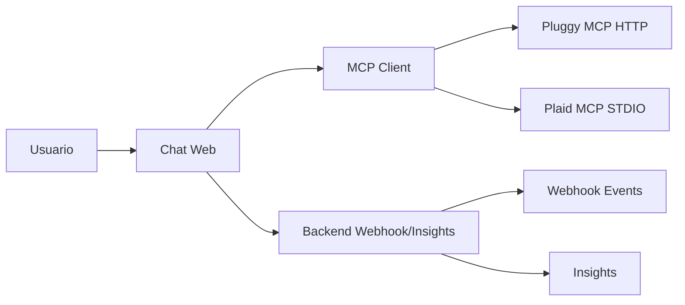

# chat-financeiro-mcp

Assistente financeiro em formato de chat, que leva o banco ate onde o cliente ja esta.
Responde em portugues sobre contas, saldos e transacoes, com dados chegando por MCP.

> Aviso: todos os dados financeiros usados neste projeto sao ficticios (sandbox).
> Nenhuma chave, token ou senha deve ser versionada ou aparecer em prints.

## 1. Onde o cliente ja esta

- Nome do projeto/assistente: Core Finance (tom empatico).
- Slogan: O núcleo inteligente para suas conexões de Open Finance.
- Autora: Valquiria Coelho.
- Cenario: aplicacao conectada por MCP de Open Finance, usando a Pluggy
  como gerador de conexao e interface de front-end.
- O assistente responde em portugues sobre contas, saldos e transacoes.

## 2. De onde vem cada dado

| Dado | Fonte | Tipo de MCP | Observacao |
|---|---|---|---|
| Conceitos de Open Finance BR (Item, connector, consentimento) | Pluggy (docs) | Streamable HTTP (`https://mcp.pluggy.ai/mcp`) | Sem chave; apenas documentacao |
| Contas, saldos e transacoes ficticias | Plaid (sandbox) | STDIO (`uvx mcp-server-plaid`) | Requer `PLAID_CLIENT_ID` e `PLAID_SECRET` |
| Organizacao da resposta em linguagem simples | Modelo de linguagem do chat | - | Nao "sabe" o saldo; organiza o que a tool devolve |

## 3. Como configurar os servidores MCP

O MCP (Model Context Protocol) e a tomada padrao entre a IA e as fontes externas.

Adicione um servidor MCP do tipo Streamable HTTP com a URL:

```
https://mcp.pluggy.ai/mcp
```

Sem chave. Confira com `/mcp` e peca a IA para explicar o que e um Item,
citando as fontes retornadas.

**Print esperado (adicione em `evidencias/`):**

```

```

> O print deve mostrar: a tela de configuracao de servidor MCP com a URL
> `https://mcp.pluggy.ai/mcp` preenchida e, opcionalmente, a resposta da IA ao
> comando `/mcp`. **Nunca exponha chaves ou tokens.**

### 3.2 Servidor Plaid (STDIO)

1. Copie o `Client ID` e o `Secret` de Sandbox em Developers > Keys.
2. Instale o `uv` (no Windows, `uv`/`uvx` precisam estar no PATH).
3. Adicione o servidor MCP do tipo STDIO com o caminho absoluto do `uvx` e o comando `mcp-server-plaid`.
4. Configure as variaveis de ambiente:
   - `PLAID_CLIENT_ID`
   - `PLAID_SECRET`
   - (opcional) `PLAID_ENV=sandbox`

Exemplo de configuracao (ajuste o caminho do `uvx` para o seu computador):

```json
{
  "mcpServers": {
    "plaid": {
      "command": "CAMINHO_ABSOLUTO_PARA_UVX",
      "args": ["mcp-server-plaid"],
      "env": {
        "PLAID_CLIENT_ID": "seu_client_id_sandbox",
        "PLAID_SECRET": "seu_secret_sandbox",
        "PLAID_ENV": "sandbox"
      }
    }
  }
}
```

> **Atenção:** substitua `CAMINHO_ABSOLUTO_PARA_UVX` pelo caminho real do `uvx.exe`
> no seu computador. Nunca commite este arquivo com credenciais reais.

**Print esperado (adicione em `evidencias/`):**

```

```

> O print deve mostrar: o bloco JSON da configuracao MCP (com credenciais
> **borradas ou substituídas por `<oculto>`**) e a resposta da IA listando
> contas/saldos ficticios. **Nunca exponha `PLAID_CLIENT_ID` ou
> `PLAID_SECRET`.**

### 3.3 Verificacao cruzada

Após configurar ambos os servidores, confirme:

- [ ] Pluggy responde `/mcp` e explica o que e um Item (sem chave).
- [ ] Plaid lista contas/saldos/transacoes ficticias (com `PLAID_ENV=sandbox`).
- [ ] A IA consegue diferenciar conta corrente (saldo) de cartao (fatura em aberto / divida).
- [ ] Nenhuma credencial aparece em prints ou no README.

## 4. Especificacao / prompt enviado ao builder (v0 ou Lovable)

Ver arquivo `docs/prompt-v0.md` (formato OpenSpec, pronto para colar no v0) e `docs/design-system.md` (direcao de arte premium).
Também disponível: `docs/prompt-lovable.md` (backup para Lovable).
Ajustes feitos depois:
- Nome alterado para Core Finance com tagline: "O núcleo inteligente para suas conexões de Open Finance".
- Tom empatico e cenario Open Finance via Pluggy.

## 5. Melhoria escolhida

Etapa 2: backend proprio com as chaves apenas no servidor (em vez de chaves no cliente).
Inclui recebimento de webhooks (ver `docs/webhooks.md`) e entrega ao cliente
por push, SMS ou WhatsApp.

## 6. Endereco do app publicado

- https://core-finance-nine.vercel.app

## 7. Estrutura do repositorio

```
chat-financeiro-mcp/
  README.md
  SECURITY.md
  frontend/
    (Next.js gerado pelo v0 e exportado para GitHub)
  backend/
    server.js
    insights.js
    package.json
    .env.example
    public/
      index.html
  data/
    transactions_labeled.json
  docs/
    prompt-lovable.md
    prompt-v0.md
    design-system.md
    tabela-padroes-gasto.md
    webhooks.md
    oauth-mcp.md
  scripts/
    generate_dataset.py
    evaluate_categorization.js
  tests/
    insights.test.js
  .github/
    workflows/
      ci.yml
  evidencias/
    Print 01.png
    Print 01.1.png
    Print 02.png
    Print 02.1.png
    Print 02.2.png
    Print 02.3.png
    Print 03.png
    Print 03.1.png
    Print 03.3.png
    Print 03.4.png
    Print 03.5.png
    Print 04.png
    Print 04.1.png
    Print 04.2.png
```

## 9. Acuracia de categorizacao (avaliacao)

- Dataset: `data/transactions_labeled.json` (150 transacoes rotuladas).
- Baseline por regras de palavras-chave (merchant/descricao).
- Resultado: 142/150 acertos = **94.67%**.
- Script: `scripts/evaluate_categorization.js`.
- Proximo passo: comparar com classificador supervisionado e medir por categoria.

## 10. Insights automaticos

Endpoint `/insights` (backend) retorna:
- assinaturas recorrentes (merchant com >=3 ocorrencias e baixa variancia);
- gastos fora do padrao (outliers > 2 desvios por categoria);
- previsao de fechamento do mes (media diaria * dias restantes).

## 11. Diagrama (Mermaid)



## 12. Decisoes tecnicas (ADRs curtos)

- ADR-01: Etapa 1 com chaves no cliente para prototipar rapido; Etapa 2 move segredos para backend.
- ADR-02: Pluggy como fonte de documentacao (sem dados reais); Plaid como sandbox de dados.
- ADR-03: Valor positivo = saida (Plaid); cartao rotulado como divida.
- ADR-04: Backend em Node/Express com zod, logs estruturados e retries.
- ADR-05: Webhooks com idempotencia e processamento assincrono.

## 13. O que faria diferente

- Comecar com backend (Etapa 2) desde o inicio para evitar migracao de segredos.
- Usar OAuth no MCP em vez de token na URL.
- Persistir eventos em banco (nao em memoria) e usar fila.
- Adicionar testes de contrato para as tools MCP com mocks.
- Medir acuracia por categoria e usar modelo supervisionado.

## 14. Seguranca

- Nenhuma chave, token ou senha versionada.
- Nenhuma chave aparece em print.
- Dados ficticios (sandbox) claramente sinalizados no app.
- Detalhes em `SECURITY.md`.

