# Core Finance

**Open Finance portfolio project | Next.js · TypeScript · Plaid Sandbox · Pluggy · Supabase**


[](https://github.com/valquiria87/core-finance/actions/workflows/ci.yml)
[](https://core-finance-nine.vercel.app/)
**Sandbox data only — no real bank accounts.**

[Leia em português](README.pt-BR.md)

Core Finance combines a financial dashboard with a Portuguese conversational interface. It organizes account snapshots and transactions, calculates rule-based indicators, and answers questions using the saved financial dataset.

> **Important:** the dashboard and chat use fictional Plaid Sandbox data. Pluggy remains an independent alternative integration. Neither integration uses real bank accounts in this project.

## DIO challenge map

| Deliverable | Where to find it |
|---|---|
| Client/user and assistant experience | The customer-facing chat is embedded in the dashboard and opened from the floating “Falar com o Core” launcher. It answers questions about balances, transactions, spending by category/month, and patterns available in the Sandbox snapshot; see the chat and dashboard captures in [evidencias/](evidencias/). |
| Builder (v0) prompt/specification | Reconstructed brief below. The original verbatim prompt was not retained in the repository, so this is a faithful scope summary, not a quotation. |
| MCP: Pluggy documentation | Streamable HTTP endpoint: `https://mcp.pluggy.ai/mcp`; documentation research screenshots in `evidencias/pluggy-docs-mcp-*.png`. |
| MCP in chat runtime | Internal MCP server and client using the official SDK; read-only `get_finance_snapshot` tool supplies the Plaid snapshot to chat. |
| Custom remote MCP Edge Function | Local implementation at `supabase/functions/dio-bank-mcp`, using Streamable HTTP and the read-only `resumo_mensal` tool against Pluggy Sandbox. Tests pass locally; Supabase secrets are configured, but the function has **not** been deployed and no remote endpoint has been validated. See its [function README](supabase/functions/dio-bank-mcp/README.md). |
| Plaid Sandbox integration | Official SDK in the Next.js server to retrieve accounts and transactions. |
| Selected improvement | **Server-side financial integration:** Plaid Sandbox powers the dashboard and chat; Pluggy retains its independent adapter, Supabase persistence, and webhook. |
| Available evidence | `plaid-sandbox-*.png` records the MCP/Plaid lab run in October 2026; it is historical evidence, not a screenshot of the current UI. `pluggy-sandbox-*.png` belongs to the previous Pluggy prototype. |

### Improvements and learnings after initial generation

#### What improved

- The dashboard and chat data path was consolidated on Plaid Sandbox, with credentials kept server-side.
- Accounts and transactions are normalized into one internal model; transaction sync follows cursor pagination and filters records to the last 90 days.
- Account and transaction currencies are preserved, avoiding USD values being presented as BRL or totals being mixed across currencies.
- The insights endpoint was aligned with the same Plaid snapshot used by the dashboard, removing its accidental dependency on the Pluggy snapshot.
- The chat now retrieves its snapshot through a real MCP tool call (`get_finance_snapshot`), using the official SDK and an in-memory transport inside the Next.js backend.
- Pluggy remains an independent alternative integration rather than replacing the Plaid path.
- Account totals now separate available cash, credit/loan debt, and investments instead of combining unlike balances.
- Card-bill payments and internal transfers are excluded from external cash-flow totals to avoid double counting.
- Transactions with unknown provider categories are labeled **Other / unclassified** instead of being incorrectly assigned to Shopping.

#### What I learned

- Configuring an MCP server in a development client does not make a web application execute MCP tools at runtime.
- Financial integrations must keep credentials server-side, handle pagination, validate external responses, and preserve each record's currency.
- Provider adapters isolate API differences; contract and route tests help catch regressions without live provider calls in the test suite.

**Important limitation:** the chat remains deterministic and does not use an LLM. At runtime, the backend creates an MCP server and MCP client in the same process; the client calls the read-only `get_finance_snapshot` tool, which queries Plaid Sandbox server-side. The transport is in-memory, so there is no publicly reachable remote MCP endpoint. MCP activities in the development client and the internal runtime MCP flow are separate.

### Reconstructed builder brief and changes after generation

**Reconstructed v0 brief (summary, not verbatim):** build a responsive Open Finance dashboard with account balances, card information, categorized transactions, spending insights, and a Portuguese chat assistant; use a modern financial-product interface and fictional data for the demonstration.

**Integrations:** the Next.js runtime calls Plaid Sandbox server-side with the official SDK, gets accounts from `/accounts/get`, and follows every page from `/transactions/sync`. Both routes use the normalized `SandboxSnapshot`. `/api/sandbox` queries Plaid directly; `/api/core` retrieves the snapshot through the internal MCP tool before running the deterministic answer engine. Pluggy remains available through its own modules, webhook, and persistence and is not part of the Plaid request path.

### MCP configuration

**Pluggy documentation server — remote Streamable HTTP**

```json
{
  "mcpServers": {
    "pluggy-docs": {
      "url": "https://mcp.pluggy.ai/mcp"
    }
  }
}
```

**Plaid Sandbox — local STDIO via uvx**

```json
{
  "mcpServers": {
    "plaid": {
      "command": "uvx",
      "args": [
        "mcp-server-plaid",
        "--client-id",
        "YOUR_PLAID_CLIENT_ID",
        "--secret",
        "YOUR_PLAID_SECRET"
      ]
    }
  }
}
```

Use Plaid **Sandbox** credentials only. Do not paste credentials into README, screenshots, source control, or chat. The Plaid screenshots are historical evidence and may differ from the data returned by the current API.

## Product behavior

- Account and balance overview; card bill and credit limit are shown separately.
- Transaction list, categories, and filters.
- Spending summaries by category and period.
- Portuguese chat for questions about balances, transactions, and spending.
- Currency formatting follows the provider's currency field; the currently validated Plaid Sandbox snapshot uses USD. No foreign-exchange conversion is performed.
- Pluggy webhook refreshes the configured Sandbox Item and persists the resulting snapshot.

**Assistant implementation:** the current chat is a **deterministic, rule- and keyword-based assistant** in `lib/core-engine.ts`. It does not call an LLM and does not execute its own MCP tools. Deployment of the remote MCP server, LLM tool calling, and systematic question/answer evaluation remain roadmap items. The `dio-bank-mcp` Edge Function has been implemented locally but has not yet been deployed. The project is not represented as a production AI agent.

## Engineering highlights

- **Plaid snapshot:** Plaid responses are normalized by `lib/plaid-adapter.ts` and shared by dashboard and chat routes.
- **Webhook idempotency:** `webhook_events.event_id` prevents duplicate event registration.
- **Processing lease and compare-and-set:** a five-minute lease allows recovery of stale/failed events while conditional updates prevent an older worker from overwriting a newer claim.
- **Provider contract tests:** mocked Pluggy auth, accounts, transaction pagination, and adapter behavior.
- **Webhook tests:** validation, authentication, duplicates, lease recovery, synchronization, and failure paths.
- **Failure notification:** `lib/webhook-alert-email.ts` sends an email when webhook synchronization fails, when Gmail SMTP is configured.

## Architecture

The Next.js application uses server-side Route Handlers. The dashboard queries Plaid directly; chat calls the internal `get_finance_snapshot` MCP tool, which uses the same Plaid integration. Pluggy synchronization and Supabase persistence remain a separate alternative path.

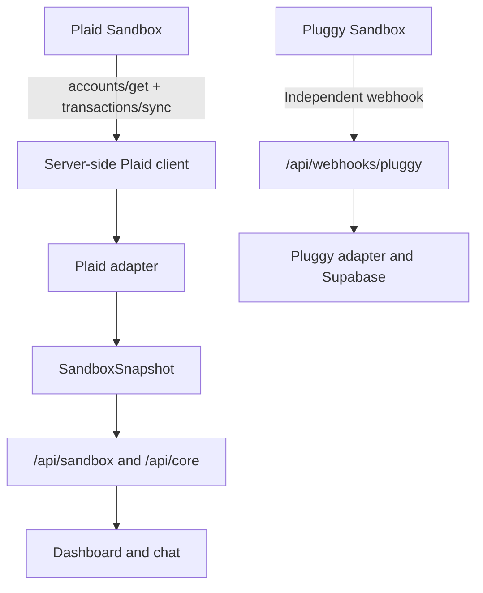

### API routes

| Route | Purpose |
|---|---|
| `GET /api/sandbox` | Queries Plaid Sandbox and returns the normalized dashboard snapshot. |
| `POST /api/core` | Calls `get_finance_snapshot` through the internal MCP client and answers with deterministic rules. |
| `GET /api/insights` | Calculates the currently implemented indicators. |
| `POST /api/webhooks/pluggy` | Validates a Pluggy notification, refreshes data, and persists the snapshot. |
| `POST /api/webhooks/plaid` | Validates the Plaid ES256 `Plaid-Verification` JWT and acknowledges the event; it does not trigger snapshot synchronization. |

The Express application in `backend/` is a separate prototype, not the backend serving the deployed Next.js application.

## Data and persistence

- **Dashboard and chat source:** Plaid Sandbox API.
- **Independent alternative:** Pluggy Sandbox API and webhook.
- **Persistence:** Supabase Postgres.
- **Snapshot:** `finance_snapshots`, keyed by Pluggy Item ID.
- **Event tracking:** `webhook_events`, including event ID, type, status, attempts, and processing timestamps.
- **Webhook health:** restricted aggregate view `webhook_event_health`.
- **Credentials:** Plaid, Pluggy, Supabase, and Gmail credentials are server-side environment variables.

The last validated Pluggy Sandbox snapshot contained 2 accounts and 41 transactions. Counts and values may change when the Sandbox data is refreshed. The data is fictional. The snapshot does not provide historical bank balances.

## Current limitations and interpretation

- No production connection to real financial institutions or real customer data.
- The assistant is deterministic and does not use an LLM or autonomous tool selection. The backend invokes an internal MCP tool over in-memory transport; no remotely reachable MCP server is integrated into the chat.
- Merchant matching in chat uses a small fixed keyword list (for example, delivery, Uber, Netflix, Starbucks, Amazon); it is not a general merchant entity-resolution feature.
- Recurring-expense detection groups transactions by merchant and checks occurrence count and amount dispersion. It does **not** validate a billing interval or prove that a payment is a subscription.
- The month-end projection uses the current date and a simple month-to-date daily average. It is not a historical backtest or a forecast calibrated to seasonality; interpret it as an indicative heuristic only.
- Anomaly detection is a simple statistical rule over the available sample, not a trained model.
- Webhook processing is synchronous; there is no durable background queue.
- The Pluggy webhook uses a shared custom header secret and timing-safe comparison, **not HMAC signing of the request body**; `eventId` deduplication and a processing lease prevent concurrent reprocessing but do not replace cryptographic timestamp/nonce verification.
- The Plaid route validates the ES256 JWT, body hash, and `iat` window, but only acknowledges receipt; its event deduplication is process-local and not durable.
- Public API routes and rate limiting require a further security review before any real-data use.
- Sandbox history is not a complete bank statement or historical balance feed.

## Technology stack

| Area | Technology |
|---|---|
| Frontend | Next.js 16, React 19, TypeScript |
| Styling and icons | Tailwind CSS, Lucide |
| Server API | Next.js Route Handlers |
| Validation | Zod |
| Client fetching | SWR |
| Main financial provider | Plaid Sandbox API |
| Alternative provider | Pluggy Sandbox API |
| Persistence | Supabase Postgres |
| Email alert | Nodemailer with Gmail SMTP |
| Documentation research | Pluggy MCP |
| Package manager | pnpm workspace |
| Deployment | Vercel |

## Environment variables

Copy `.env.example` to a local environment file and set values on the server. Never commit real credentials.

Plaid routes require `PLAID_CLIENT_ID`, `PLAID_SECRET`, `PLAID_ENV=sandbox`, and `PLAID_ACCESS_TOKEN`. Obtain the token through the Plaid Sandbox flow and configure it only in the server environment. Do not use `NEXT_PUBLIC_*` variables.

| Variable | Purpose |
|---|---|
| `PLAID_CLIENT_ID`, `PLAID_SECRET` | Server-side Plaid SDK authentication |
| `PLAID_ENV` | Plaid environment; this project validates `sandbox` |
| `PLAID_ACCESS_TOKEN` | Server-side access to the linked Sandbox Item |
| `PLUGGY_CLIENT_ID`, `PLUGGY_CLIENT_SECRET` | Pluggy API authentication |
| `PLUGGY_ITEM_ID` | Configured Sandbox Item |
| `MCP_TOKEN` | Bearer token used only by the separate `dio-bank-mcp` Supabase Edge Function; configure it in Supabase secrets, never in the browser or a committed environment file. |
| `PLUGGY_WEBHOOK_SECRET` | Shared secret expected in the webhook header |
| `SUPABASE_URL`, `SUPABASE_SECRET_KEY` | Server-side Supabase access |
| `GMAIL_USER` | Gmail account used for SMTP |
| `GMAIL_APP_PASSWORD` | Google App Password (not the normal account password) |
| `ALERT_EMAIL_TO` | Recipient of webhook failure alerts |

Email alerts are sent only when webhook synchronization fails and all three Gmail variables are configured. Missing email configuration does not turn a successful deployment into proof that SMTP works.

## Run locally

Requirements: Node.js and pnpm.

```bash
pnpm install
cp .env.example .env.local
pnpm dev
```

Open `http://localhost:3000`.

### Validation

```bash
pnpm test
pnpm exec tsc --noEmit
pnpm build
```

## Evidence

### Current Core Finance interface (local validation)

These screenshots were captured from the current local application after the responsive layout and chat table adjustments. They show the dashboard at desktop and mobile sizes, plus deterministic chat answers for spending by category, period, and account. All records are fictional Plaid Sandbox data.

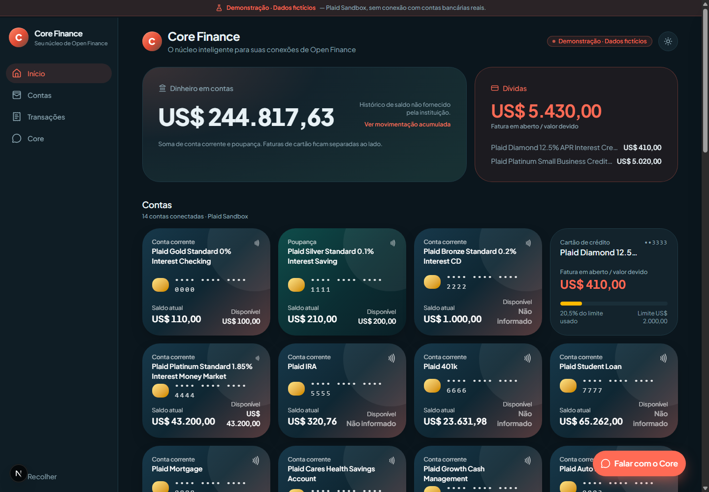
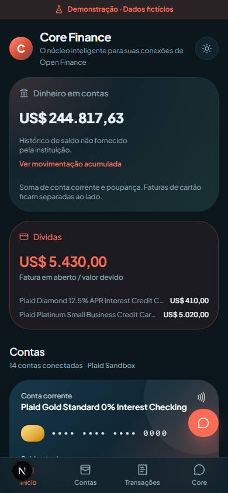
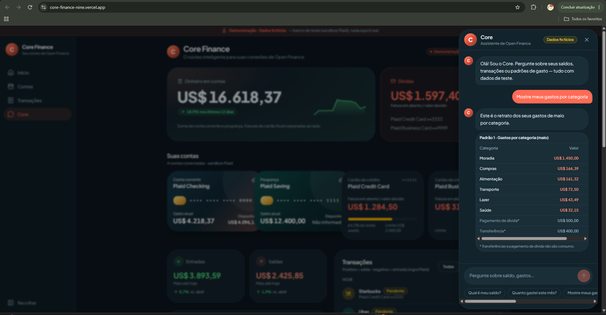
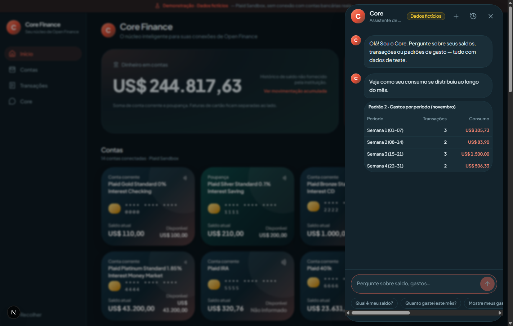
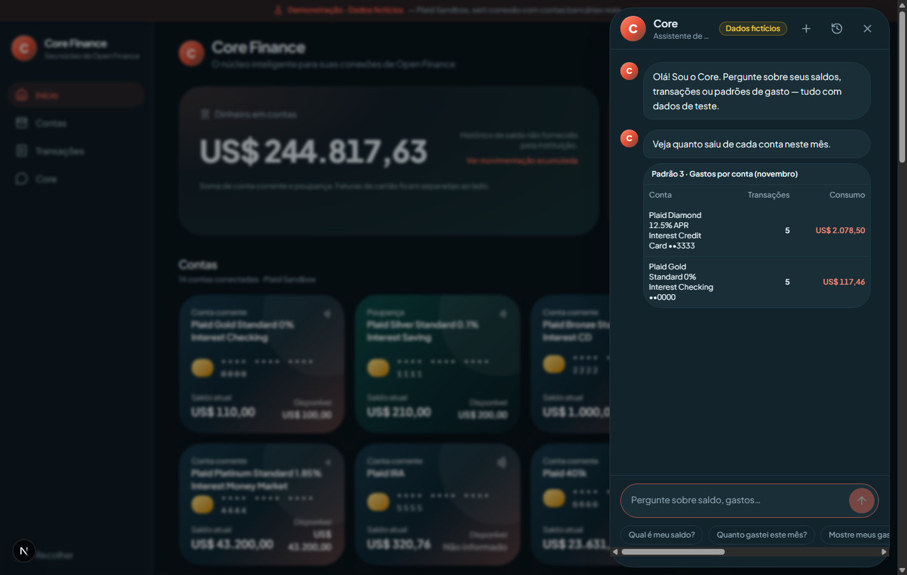

### Previous Pluggy Sandbox prototype

The following images document an earlier prototype and do not represent the data source of the current local application.

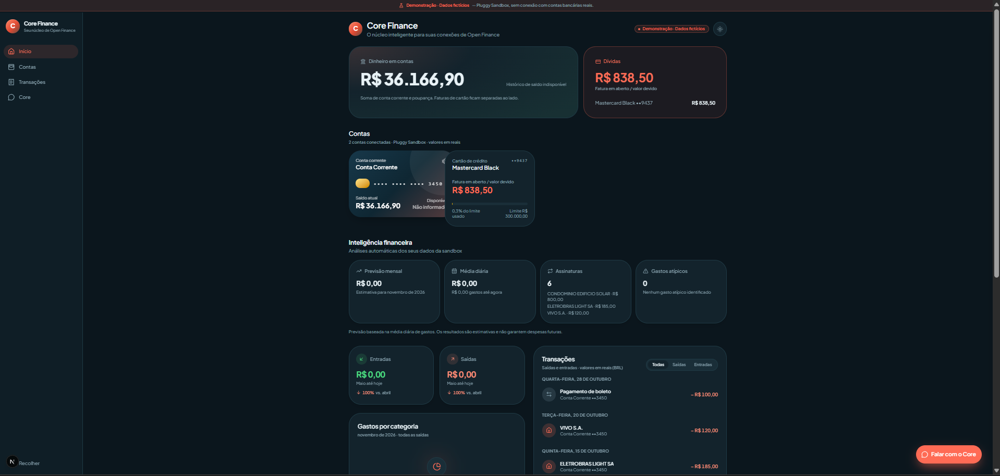
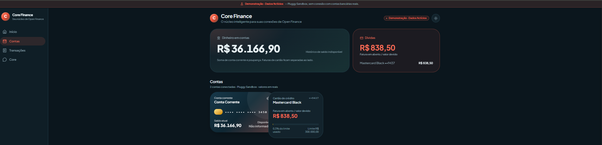
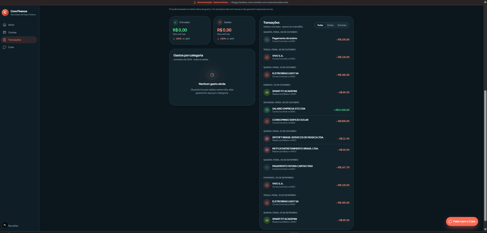
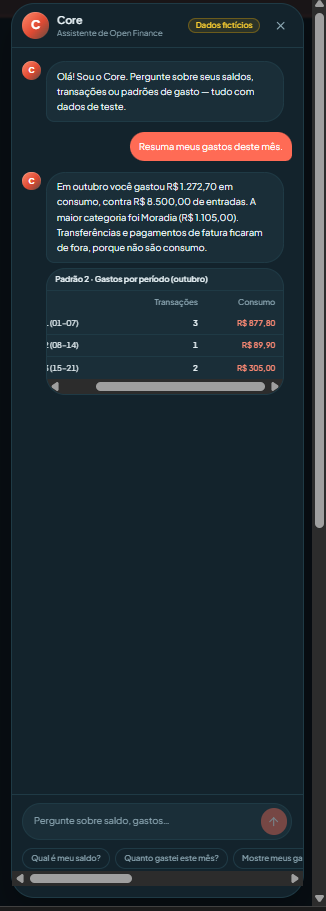

### Historical MCP/Plaid Sandbox lab evidence (October 2026)

These screenshots show the Plaid MCP server running in the development client. Their counts and dates belong to that earlier query, not to the current snapshot.

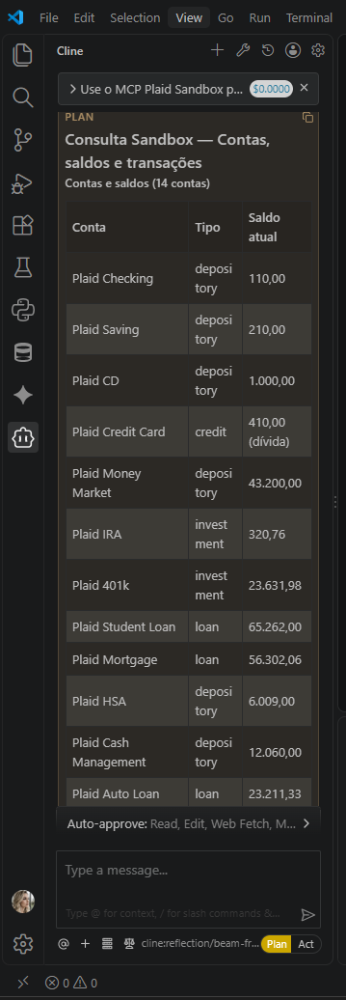
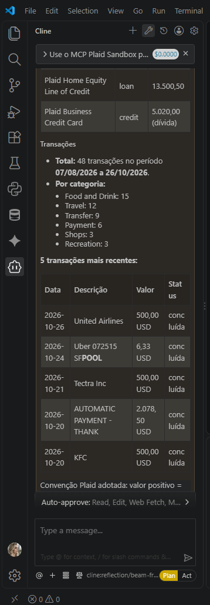
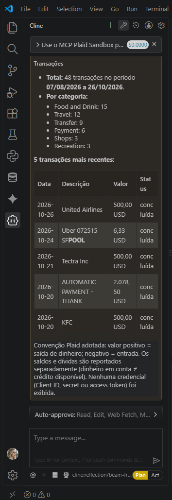

### MCP documentation research

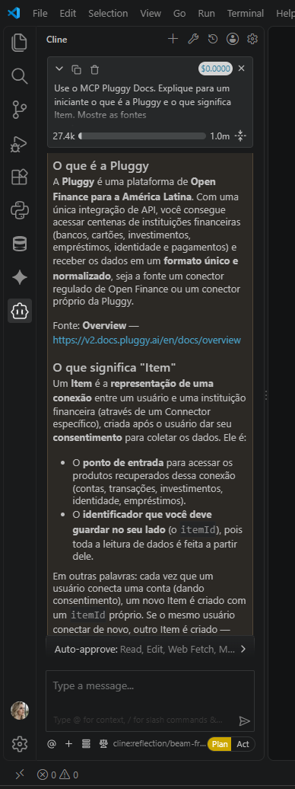
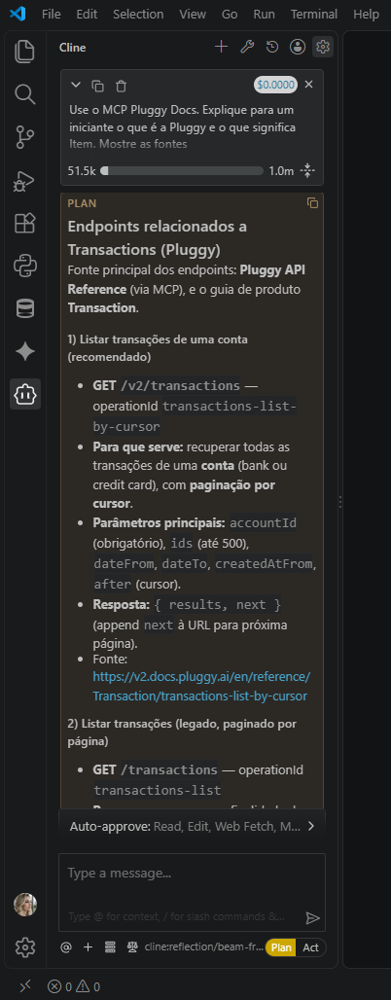

All financial records in the screenshots are test or Sandbox data.

## Roadmap

- [x] Server-side Pluggy Sandbox integration and Supabase snapshot persistence.
- [x] Webhook event deduplication, processing lease, health view, and failure email.
- [x] Pluggy contract tests and webhook tests.
- [x] Add an internal MCP server exposing the read-only `get_finance_snapshot` tool, called by the chat backend.
- [x] Implement a separate Pluggy-backed `dio-bank-mcp` Supabase Edge Function with Bearer authentication and the read-only `resumo_mensal` tool; local tests pass.
- [ ] Deploy `dio-bank-mcp` to Supabase and validate its authenticated remote Streamable HTTP endpoint.
- [ ] Integrate an LLM with explicit tool calling and server-side authorization.
- [ ] Build a question/answer evaluation set (correctness, groundedness, refusal, and regression tests).
- [ ] Add replay protection, durable asynchronous processing, rate limiting, and expanded access-control review.
- [ ] Record a 60–90 second walkthrough for the DIO submission and recruiter portfolio.

## Security

See [SECURITY.md](SECURITY.md) for implemented controls, known gaps, and vulnerability reporting.

## License

MIT — see [LICENSE](LICENSE).

## Author

**Valquiria Coelho**
