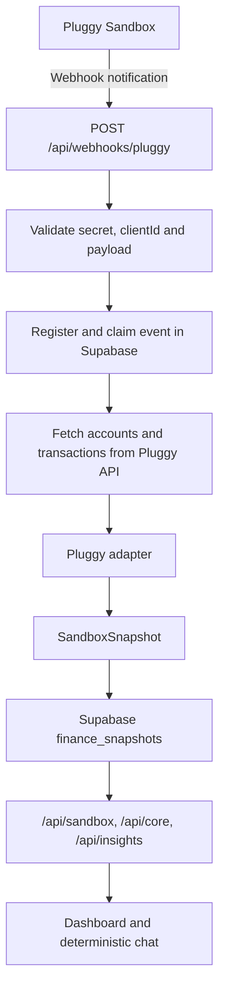

# Core Finance

**Open Finance portfolio project | Next.js · TypeScript · Pluggy Sandbox · Supabase**


[](https://github.com/valquiria87/core-finance/actions/workflows/ci.yml)
[](https://core-finance-nine.vercel.app/)
**Sandbox data only — no real bank accounts.**

[Leia em português](README.pt-BR.md)

Core Finance combines a financial dashboard with a Portuguese conversational interface. It organizes account snapshots and transactions, calculates rule-based indicators, and answers questions using the saved financial dataset.

> **Important:** the deployed project uses fictional Pluggy Sandbox data. It is not connected to real customer bank accounts and must not be used for real financial decisions.

## DIO challenge map

| Deliverable | Where to find it |
|---|---|
| Client/user and assistant experience | The customer-facing chat is embedded in the dashboard and opened from the floating “Falar com o Core” launcher. It answers questions about balances, transactions, spending by category/month, and patterns available in the Sandbox snapshot; see the chat and dashboard captures in [evidencias/](evidencias/). |
| Builder (v0) prompt/specification | Reconstructed brief below. The original verbatim prompt was not retained in the repository, so this is a faithful scope summary, not a quotation. |
| MCP: Pluggy documentation | Streamable HTTP endpoint: `https://mcp.pluggy.ai/mcp`; documentation research screenshots in `evidencias/pluggy-docs-mcp-*.png`. |
| MCP: Plaid Sandbox lab | Local STDIO server using `uvx mcp-server-plaid`; credentials are placeholders in the example below. Plaid screenshots in `evidencias/plaid-sandbox-*.png`. |
| Selected improvement | **Stage 2: server-side data integration and persistence** — Next.js webhook route, Pluggy Sandbox API adapter, Supabase snapshot storage, event deduplication, retry lease, health view, and failure email. |
| Evidence of final implementation | `evidencias/pluggy-sandbox-dashboard.png`, `pluggy-sandbox-contas-saldos.png`, `pluggy-sandbox-transacoes.png`, and `pluggy-sandbox-chat.png`. |

### Builder brief and changes after generation

**Reconstructed v0 brief (summary, not verbatim):** build a responsive Open Finance dashboard with account balances, card information, categorized transactions, spending insights, and a Portuguese chat assistant; use a modern financial-product interface and fictional data for the demonstration.

**What was refined after the initial UI:** Pluggy Sandbox was selected as the active source because it powers the final server-side integration and the data persisted for the dashboard/chat; Plaid was retained as a separate MCP learning lab. The deployed app moved to Next.js Route Handlers; the server fetches accounts and transactions, adapts them to the internal snapshot, and persists that snapshot in Supabase. The webhook gained validation, deduplication, a five-minute processing lease, failure tracking, and email notification. Currency presentation was aligned to BRL. The Plaid work remains documented as an MCP/Sandbox learning laboratory and is not the deployed runtime data source.

### MCP configuration

**Pluggy documentation server — remote Streamable HTTP**

```json
{
  "mcpServers": {
    "pluggy-docs": {
      "url": "https://mcp.pluggy.ai/mcp"
    }
  }
}
```

**Plaid Sandbox — local STDIO via uvx**

```json
{
  "mcpServers": {
    "plaid": {
      "command": "uvx",
      "args": [
        "mcp-server-plaid",
        "--client-id",
        "YOUR_PLAID_CLIENT_ID",
        "--secret",
        "YOUR_PLAID_SECRET"
      ]
    }
  }
}
```

Use Plaid **Sandbox** credentials only for this laboratory. Do not paste credentials into README, screenshots, source control, or chat. The Plaid screenshots are historical lab evidence: they show the Sandbox exploration (including the captured 14 accounts and 48 transactions), not the current Pluggy-backed application.

## Product behavior

- Account and balance overview; card bill and credit limit are shown separately.
- Transaction list, categories, and filters.
- Spending summaries by category and period.
- Portuguese chat for questions about balances, transactions, and spending.
- BRL currency formatting.
- Pluggy webhook refreshes the configured Sandbox Item and persists the resulting snapshot.

**Assistant implementation:** the current chat is a **deterministic, rule- and keyword-based assistant** in `lib/core-engine.ts`. It does not call an LLM and does not execute its own MCP tools. A dedicated MCP server, LLM with tool calling, and systematic question/answer evaluation remain roadmap items. The project is not represented as a production AI agent.

## Engineering highlights

- **Persisted snapshot:** Pluggy API responses are normalized by `lib/pluggy-adapter.ts` and saved to Supabase `finance_snapshots`; dashboard routes read the saved snapshot.
- **Webhook idempotency:** `webhook_events.event_id` prevents duplicate event registration.
- **Processing lease and compare-and-set:** a five-minute lease allows recovery of stale/failed events while conditional updates prevent an older worker from overwriting a newer claim.
- **Provider contract tests:** mocked Pluggy auth, accounts, transaction pagination, and adapter behavior.
- **Webhook tests:** validation, authentication, duplicates, lease recovery, synchronization, and failure paths.
- **Failure notification:** `lib/webhook-alert-email.ts` sends an email when webhook synchronization fails, when Gmail SMTP is configured.

## Architecture

The deployed Next.js application uses server-side Route Handlers. The dashboard and chat read the latest synchronized snapshot from Supabase; they do not independently fetch Pluggy data on every page request.



### API routes

| Route | Purpose |
|---|---|
| `GET /api/sandbox` | Returns the latest saved financial snapshot. |
| `POST /api/core` | Answers a financial question using the saved snapshot and deterministic rules. |
| `GET /api/insights` | Calculates the currently implemented indicators. |
| `POST /api/webhooks/pluggy` | Validates a Pluggy notification, refreshes data, and persists the snapshot. |

The Express application in `backend/` is a separate prototype, not the backend serving the deployed Next.js application.

## Data and persistence

- **Active provider:** Pluggy Sandbox API.
- **Learning laboratory:** Plaid Sandbox MCP and historical screenshots.
- **Persistence:** Supabase Postgres.
- **Snapshot:** `finance_snapshots`, keyed by Pluggy Item ID.
- **Event tracking:** `webhook_events`, including event ID, type, status, attempts, and processing timestamps.
- **Webhook health:** restricted aggregate view `webhook_event_health`.
- **Credentials:** Pluggy, Supabase, and Gmail credentials are server-side environment variables.

The last validated Pluggy Sandbox snapshot contained 2 accounts and 41 transactions. Counts and values may change when the Sandbox data is refreshed. The data is fictional. The snapshot does not provide historical bank balances.

## Current limitations and interpretation

- No production connection to real financial institutions or real customer data.
- The assistant is deterministic; no LLM or application-owned MCP server is integrated.
- Merchant matching in chat uses a small fixed keyword list (for example, delivery, Uber, Netflix, Starbucks, Amazon); it is not a general merchant entity-resolution feature.
- Recurring-expense detection groups transactions by merchant and checks occurrence count and amount dispersion. It does **not** validate a billing interval or prove that a payment is a subscription.
- The month-end projection uses the current date and a simple month-to-date daily average. It is not a historical backtest or a forecast calibrated to seasonality; interpret it as an indicative heuristic only.
- Anomaly detection is a simple statistical rule over the available sample, not a trained model.
- Webhook processing is synchronous; there is no durable background queue.
- The webhook uses a shared custom header secret and timing-safe comparison, **not HMAC signing of the request body**. A replay-protection mechanism is not implemented.
- Public API routes and rate limiting require a further security review before any real-data use.
- Sandbox history is not a complete bank statement or historical balance feed.

## Technology stack

| Area | Technology |
|---|---|
| Frontend | Next.js 16, React 19, TypeScript |
| Styling and icons | Tailwind CSS, Lucide |
| Server API | Next.js Route Handlers |
| Validation | Zod |
| Client fetching | SWR |
| Financial provider | Pluggy Sandbox API |
| Persistence | Supabase Postgres |
| Email alert | Nodemailer with Gmail SMTP |
| Documentation research | Pluggy MCP |
| Package manager | pnpm workspace |
| Deployment | Vercel |

## Environment variables

Copy `.env.example` to a local environment file and set values on the server. Never commit real credentials.

| Variable | Purpose |
|---|---|
| `PLUGGY_CLIENT_ID`, `PLUGGY_CLIENT_SECRET` | Pluggy API authentication |
| `PLUGGY_ITEM_ID` | Configured Sandbox Item |
| `PLUGGY_WEBHOOK_SECRET` | Shared secret expected in the webhook header |
| `SUPABASE_URL`, `SUPABASE_SECRET_KEY` | Server-side Supabase access |
| `GMAIL_USER` | Gmail account used for SMTP |
| `GMAIL_APP_PASSWORD` | Google App Password (not the normal account password) |
| `ALERT_EMAIL_TO` | Recipient of webhook failure alerts |

Email alerts are sent only when webhook synchronization fails and all three Gmail variables are configured. Missing email configuration does not turn a successful deployment into proof that SMTP works.

## Run locally

Requirements: Node.js and pnpm.

```bash
pnpm install
cp .env.example .env.local
pnpm dev
```

Open `http://localhost:3000`.

### Validation

```bash
pnpm test
pnpm exec tsc --noEmit
pnpm build
```

## Evidence

### Final Pluggy Sandbox application


### Plaid Sandbox laboratory


### MCP documentation research


All financial records in the screenshots are test or Sandbox data.

## Roadmap

- [x] Server-side Pluggy Sandbox integration and Supabase snapshot persistence.
- [x] Webhook event deduplication, processing lease, health view, and failure email.
- [x] Pluggy contract tests and webhook tests.
- [ ] Add a project-owned MCP server exposing safe, read-only financial tools.
- [ ] Integrate an LLM with explicit tool calling and server-side authorization.
- [ ] Build a question/answer evaluation set (correctness, groundedness, refusal, and regression tests).
- [ ] Add replay protection, durable asynchronous processing, rate limiting, and expanded access-control review.
- [ ] Record a 60–90 second walkthrough for the DIO submission and recruiter portfolio.

## Security

See [SECURITY.md](SECURITY.md) for implemented controls, known gaps, and vulnerability reporting.

## License

MIT — see [LICENSE](LICENSE).

## Author

**Valquiria Coelho**
