# chat-financeiro-mcp

Assistente financeiro em formato de chat, que leva o banco ate onde o cliente ja esta.
Responde em portugues sobre contas, saldos e transacoes, com dados chegando por MCP.

> Aviso: todos os dados financeiros usados neste projeto sao ficticios (sandbox).
> Nenhuma chave, token ou senha deve ser versionada ou aparecer em prints.

## 1. Onde o cliente ja esta

- Nome do projeto/assistente: Core Finance (tom empatico).
- Slogan: O núcleo inteligente para suas conexões de Open Finance.
- Autora: Valquiria Coelho.
- Cenario: aplicacao web (Next.js) com chat e dashboard, conectada por MCP de Open Finance.
  A Pluggy e usada como fonte de documentacao (conceitos de Open Finance BR); os dados
  financeiros exibidos sao ficticios (mock local no formato da sandbox Plaid — Etapa 1).
- O assistente responde em portugues sobre contas, saldos e transacoes.

## 2. De onde vem cada dado

| Dado | Fonte | Tipo | Observacao |
|---|---|---|---|
| Conceitos de Open Finance BR (Item, connector, consentimento) | Pluggy (documentacao) | MCP Streamable HTTP (`https://mcp.pluggy.ai/mcp`) | Sem chave; apenas documentacao |
| Contas, saldos e transacoes ficticias (Etapa 1) | Mock local espelhando o formato da sandbox Plaid | Dados estaticos em `lib/mock-data.ts` (rota `/api/sandbox`) | Sem credenciais; `PLAID_CLIENT_ID`/`PLAID_SECRET` so serao usados na Etapa 2 (backend) |
| Organizacao da resposta em linguagem simples | Modelo de linguagem do chat | - | Nao "sabe" o saldo; organiza o que a fonte devolve |

> Nota: a aplicacao atual (Etapa 1) NAO chama a API da Plaid nem a da Pluggy em runtime.
> Os dados sao ficticios e locais. A Etapa 2 (backend com chaves no servidor) esta planejada,
> nao implementada em producao.

## 3. Como configurar os servidores MCP

O MCP (Model Context Protocol) e a tomada padrao entre a IA e as fontes externas.

Adicione um servidor MCP do tipo Streamable HTTP com a URL:

```
https://mcp.pluggy.ai/mcp
```

Sem chave. Confira com `/mcp` e peca a IA para explicar o que e um Item,
citando as fontes retornadas.

Sem prints de configuracao versionados entre as evidencias disponiveis. Use a secao 15 para as evidencias visuais renomeadas.

### 3.2 Servidor Plaid (STDIO)

1. Copie o `Client ID` e o `Secret` de Sandbox em Developers > Keys.
2. Instale o `uv` (no Windows, `uv`/`uvx` precisam estar no PATH).
3. Adicione o servidor MCP do tipo STDIO com o caminho absoluto do `uvx` e o comando `mcp-server-plaid`.
4. Configure as variaveis de ambiente:
   - `PLAID_CLIENT_ID`
   - `PLAID_SECRET`
   - (opcional) `PLAID_ENV=sandbox`

Exemplo de configuracao (ajuste o caminho do `uvx` para o seu computador):

```json
{
  "mcpServers": {
    "plaid": {
      "command": "CAMINHO_ABSOLUTO_PARA_UVX",
      "args": ["mcp-server-plaid"],
      "env": {
        "PLAID_CLIENT_ID": "seu_client_id_sandbox",
        "PLAID_SECRET": "seu_secret_sandbox",
        "PLAID_ENV": "sandbox"
      }
    }
  }
}
```

> **Atenção:** substitua `CAMINHO_ABSOLUTO_PARA_UVX` pelo caminho real do `uvx.exe`
> no seu computador. Nunca commite este arquivo com credenciais reais.

Sem prints de configuracao versionados entre as evidencias disponiveis. Use a secao 15 para as evidencias visuais renomeadas.

### 3.3 Verificacao cruzada

Após configurar ambos os servidores, confirme:

- [ ] Pluggy responde `/mcp` e explica o que e um Item (sem chave).
- [ ] Plaid lista contas/saldos/transacoes ficticias (com `PLAID_ENV=sandbox`).
- [ ] A IA consegue diferenciar conta corrente (saldo) de cartao (fatura em aberto / divida).
- [ ] Nenhuma credencial aparece em prints ou no README.

## 4. Especificacao / prompt enviado ao builder (v0 ou Lovable)

Ver arquivo `docs/prompt-v0.md` (formato OpenSpec, pronto para colar no v0) e `docs/design-system.md` (direcao de arte premium).
Também disponível: `docs/prompt-lovable.md` (backup para Lovable).
Ajustes feitos depois:
- Nome alterado para Core Finance com tagline: "O núcleo inteligente para suas conexões de Open Finance".
- Tom empatico e cenario Open Finance via Pluggy.

## 5. Melhoria escolhida (planejada, nao implementada em producao)

Etapa 2: backend proprio com as chaves apenas no servidor (em vez de chaves no cliente).
Inclui recebimento de webhooks (ver `docs/webhooks.md`) e entrega ao cliente
por push, SMS ou WhatsApp.

O backend em `backend/` ja existe como prototipo (servidor Express com `/insights` e webhook), mas a integracao
com a API da Plaid em producao ainda nao esta ativa (Etapa 2).

## 6. Endereco do app publicado

- https://core-finance-nine.vercel.app

## 7. Estrutura do repositorio

```
core-finance/
  README.md
  SECURITY.md
  components.json
  next.config.mjs
  package.json
  pnpm-lock.yaml
  pnpm-workspace.yaml
  postcss.config.mjs
  tsconfig.json
  .gitignore
  app/
    globals.css
    layout.tsx
    page.tsx
    api/
      core/
        route.ts
      sandbox/
        route.ts
  backend/
    .env.example
    insights.js
    package.json
    package-lock.json
    server.js
    public/
      index.html
  components/
    chat/
    dashboard/
    finance/
    layout/
    ui/
  hooks/
    use-sandbox.ts
  lib/
    categories.ts
    core-engine.ts
    finance.ts
    format.ts
    mock-data.ts
    types.ts
    utils.ts
  public/
    (icones e placeholders)
  data/
    transactions_labeled.json
  docs/
    design-system.md
    oauth-mcp.md
    prompt-lovable.md
    prompt-v0.md
    tabela-padroes-gasto.md
    webhooks.md
  scripts/
    evaluate_categorization.js
    generate_dataset.py
  tests/
    insights.test.js
  evidencias/
    app-core-finance-conversa-gastos-categoria.png
    plaid-sandbox-contas-saldos.png
    plaid-sandbox-contas-transacoes-categorias.png
    plaid-sandbox-transacoes-convencao-sinais.png
    pluggy-docs-mcp-conceito-pluggy-item.png
    pluggy-docs-mcp-conceitos-connector-item-product.png
    pluggy-docs-mcp-endpoints-investments-recurring-payments.png
    pluggy-docs-mcp-endpoints-transactions.png
    pluggy-docs-mcp-endpoints-transactions-legado-retrieve-categoria.png
    pluggy-docs-mcp-referencia-transaction-autenticacao.png
    pluggy-endpoint-transactions-legado-migracao-v2.png
    pluggy-endpoint-transactions-legado-parametros.png
    pluggy-endpoint-transactions-v2-get.png
    pluggy-endpoint-transactions-v2-parametros.png
    pluggy-endpoint-transactions-v2-resposta-200-legado.png
```

## 8. Funcionalidades implementadas vs. documentadas vs. planejadas

### Implementadas (no codigo)
- Chat web + dashboard (contas, saldos, fluxo, gastos por categoria, lista de transacoes).
- Dados ficticios locais no formato Plaid sandbox (`lib/mock-data.ts`, rota `/api/sandbox`).
- Categorizacao por regras de palavras-chave (`lib/categories.ts`).
- Insights: assinaturas recorrentes, outliers por categoria, previsao de fechamento.
- Backend Express prototipo com `/insights` e webhook (`backend/server.js`, `backend/insights.js`).
- Validacao de entrada com zod no webhook.

### Documentadas (docs/)
- Especificacao OpenSpec para v0/Lovable (`docs/prompt-v0.md`, `docs/prompt-lovable.md`).
- Design system (`docs/design-system.md`).
- Tabela de padroes de gasto (`docs/tabela-padroes-gasto.md`).
- Webhooks (`docs/webhooks.md`).
- OAuth MCP (`docs/oauth-mcp.md`).

### Planejadas (nao implementadas)
- Integracao real com a API da Plaid em producao (Etapa 2).
- Validacao de assinatura de webhook em producao.
- Persistencia em banco + fila (hoje em memoria).
- Testes de contrato para tools MCP com mocks.
- Classificador supervisionado por categoria.

## 9. Acuracia de categorizacao (avaliacao)

- Dataset: `data/transactions_labeled.json` (150 transacoes rotuladas).
- Baseline por regras de palavras-chave (merchant/descricao).
- Resultado: 142/150 acertos = **94.67%**.
- Script: `scripts/evaluate_categorization.js`.
- Proximo passo: comparar com classificador supervisionado e medir por categoria.

## 10. Insights automaticos

Endpoint `/insights` (backend) retorna:
- assinaturas recorrentes (merchant com >=3 ocorrencias e baixa variancia);
- gastos fora do padrao (outliers > 2 desvios por categoria);
- previsao de fechamento do mes (media diaria * dias restantes).

## 11. Diagrama (Mermaid)

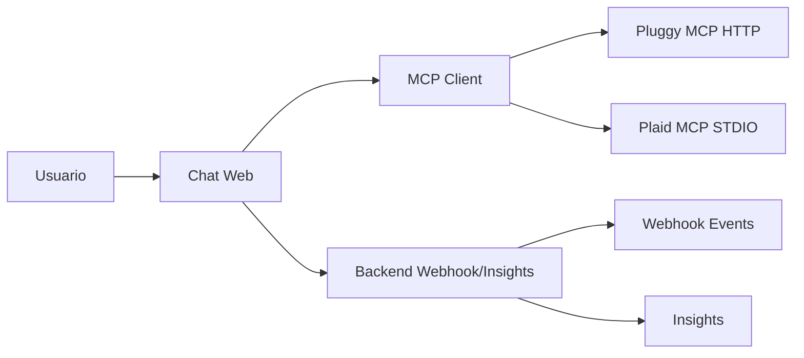

## 12. Decisoes tecnicas (ADRs curtos)

- ADR-01: Etapa 1 com chaves no cliente para prototipar rapido; Etapa 2 move segredos para backend.
- ADR-02: Pluggy como fonte de documentacao (sem dados reais); Plaid como sandbox de dados.
- ADR-03: Valor positivo = saida (Plaid); cartao rotulado como divida.
- ADR-04: Backend em Node/Express com zod, logs estruturados e retries.
- ADR-05: Webhooks com idempotencia e processamento assincrono.

## 13. O que faria diferente

- Comecar com backend (Etapa 2) desde o inicio para evitar migracao de segredos.
- Usar OAuth no MCP em vez de token na URL.
- Persistir eventos em banco (nao em memoria) e usar fila.
- Adicionar testes de contrato para as tools MCP com mocks.
- Medir acuracia por categoria e usar modelo supervisionado.

## 14. Seguranca

- Nenhuma chave, token ou senha versionada.
- Nenhuma chave aparece em print.
- Dados ficticios (sandbox) claramente sinalizados no app.
- Detalhes em `SECURITY.md`.

## 15. Evidencias visuais

### Aplicativo publicado
- 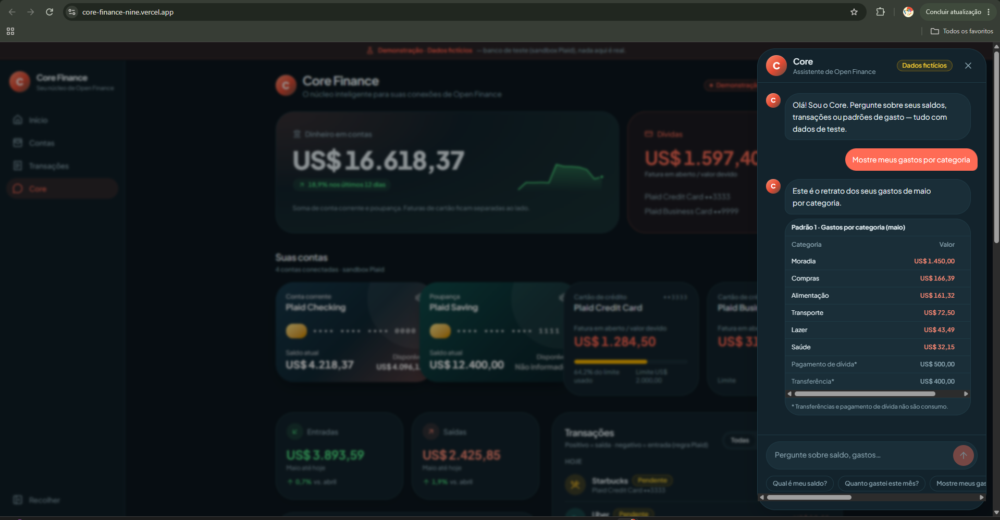 — Aplicativo Core Finance publicado, conversa do assistente sobre gastos por categoria com selo "Dados ficticios".

### Conceitos e endpoints da Pluggy (consulta via MCP Docs)
> A Pluggy foi consultada via MCP Docs. Isso nao comprova integracao bancaria funcional: a aplicacao atual (Etapa 1) nao chama a API da Pluggy em runtime.
- 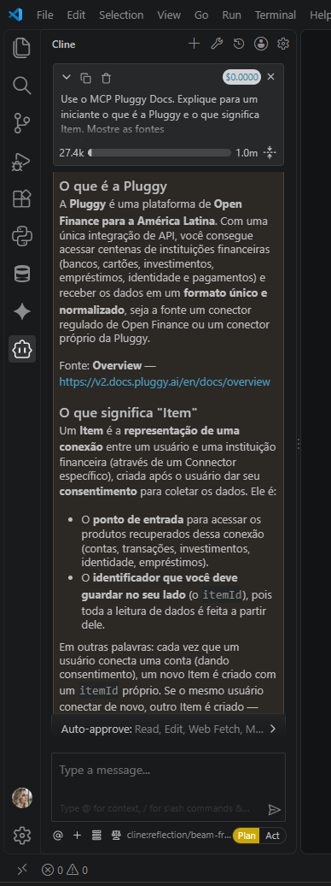 — O que e a Pluggy e o conceito de Item.
- 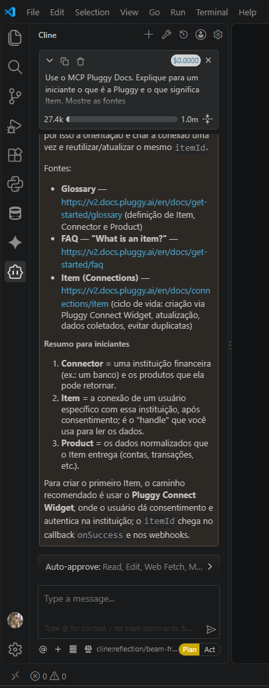 — Conceitos Connector, Item e Product.
- 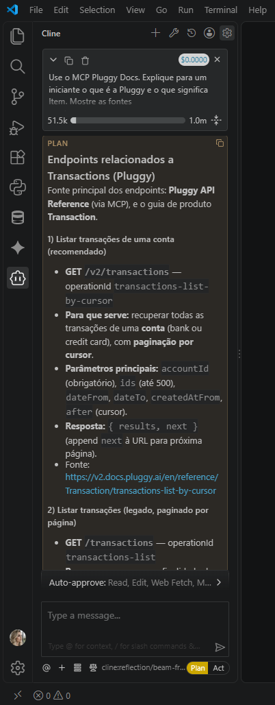 — Endpoints relacionados a Transactions.
- 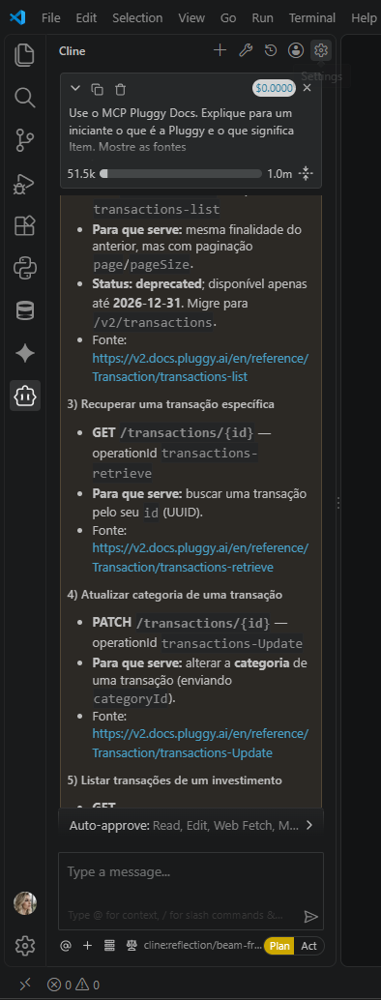 — Endpoints legado, retrieve e atualizacao de categoria.
- 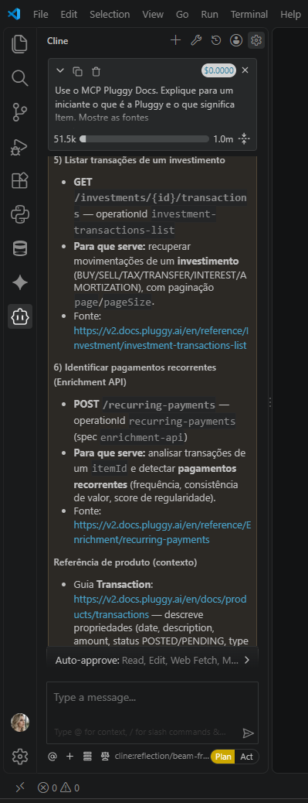 — Endpoints de investimentos e recurring-payments.
- 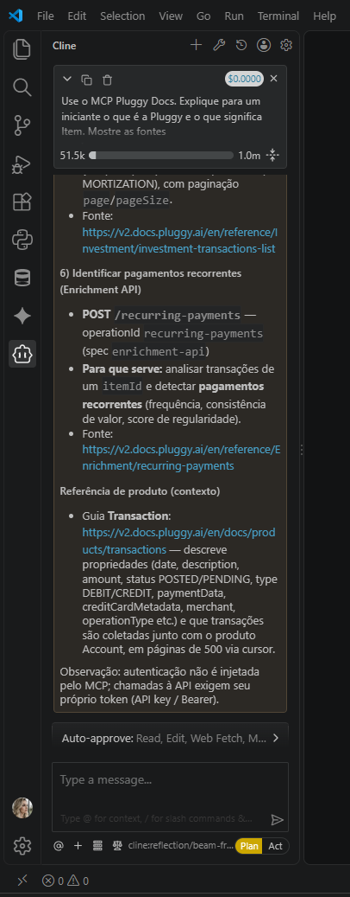 — Referencia Transaction e autenticacao com token proprio.
- 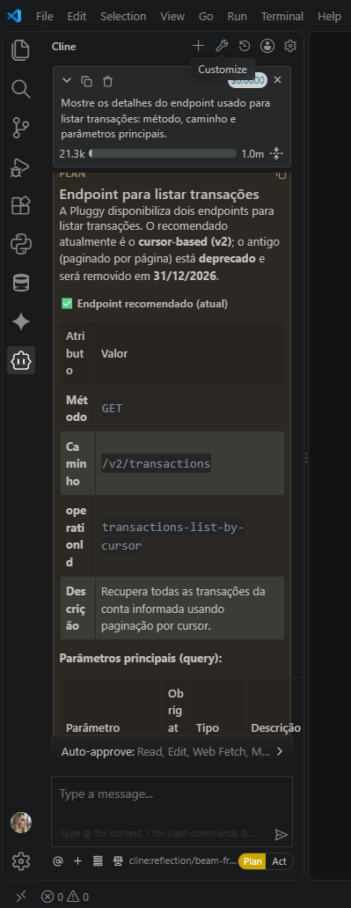 — Endpoint recomendado GET /v2/transactions.
- 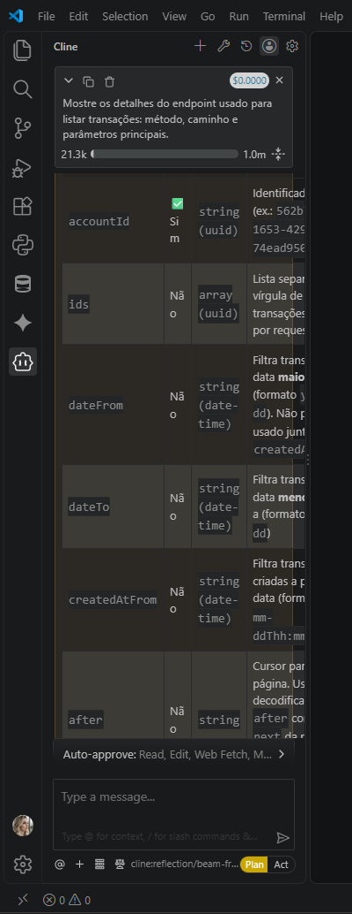 — Parametros do endpoint v2 (accountId, ids, dateFrom, dateTo, createdAtFrom, after).
- 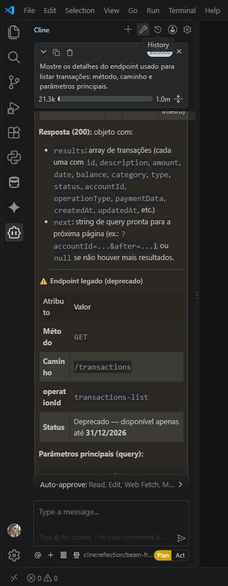 — Estrutura da resposta 200 (results, next) e inicio do endpoint legado.
- 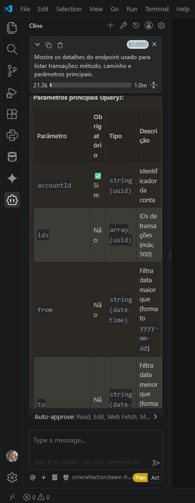 — Parametros do endpoint legado.
- 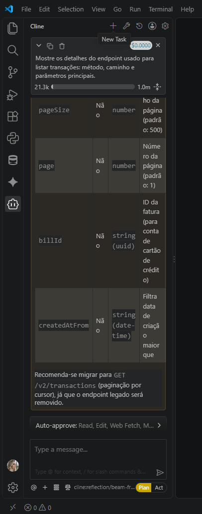 — Final dos parametros legados e recomendacao de migracao para v2.

### Consultas do Plaid Sandbox
> Os dados exibidos no aplicativo e os dados retornados pelo Plaid Sandbox sao demonstracoes distintas; nao sao o mesmo conjunto de dados.
- 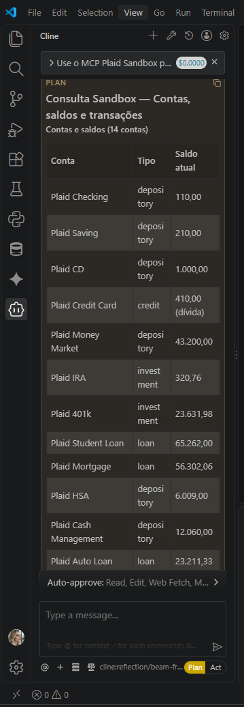 — Tabela de contas e saldos (parte das 14 contas).
- 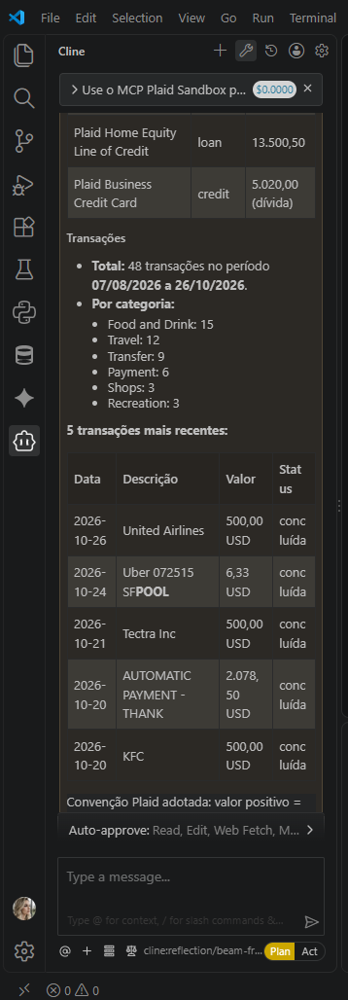 — Contas restantes e resumo de 48 transacoes por categoria.
- 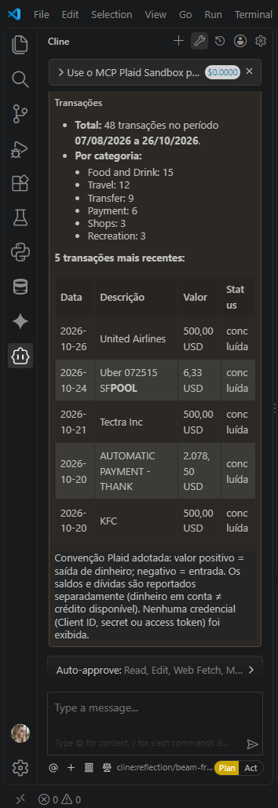 — Continuacao do resumo de transacoes e convencao de sinais.

