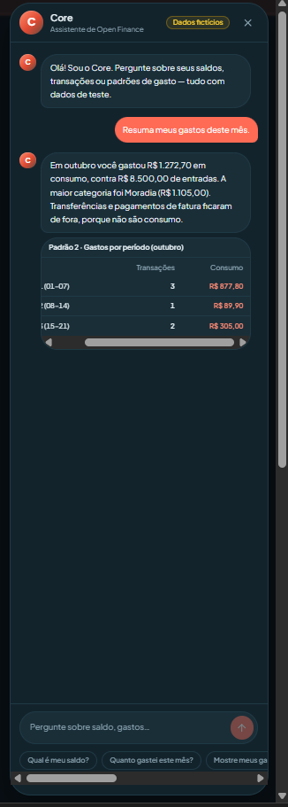
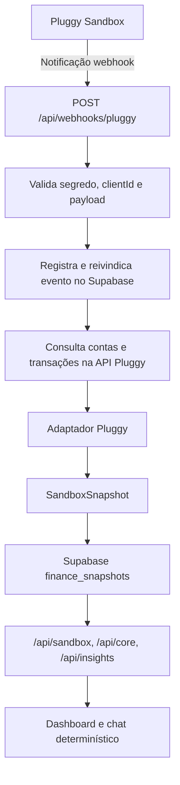
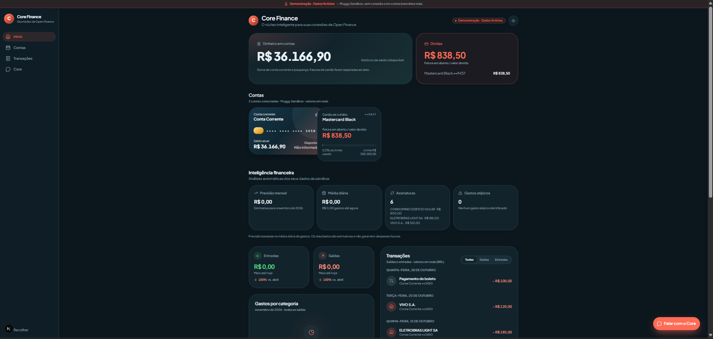
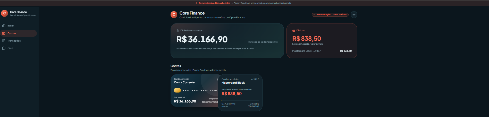
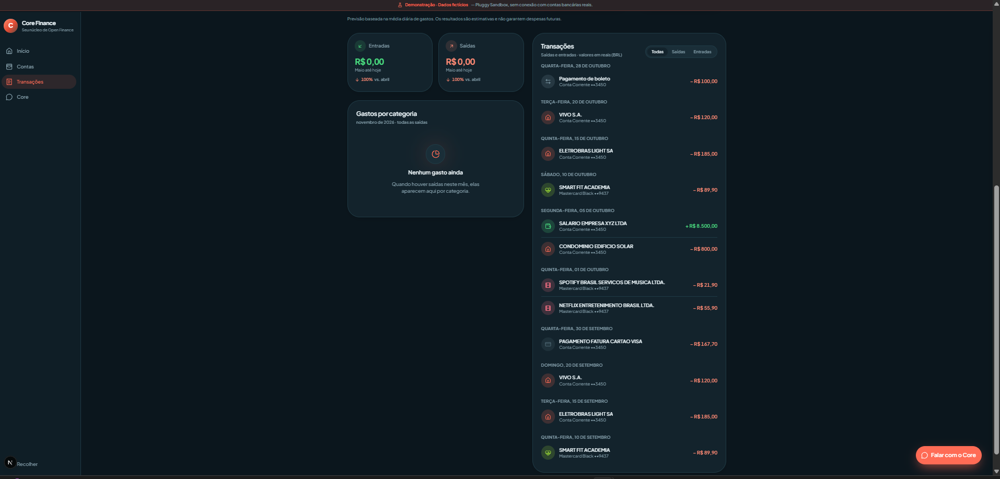
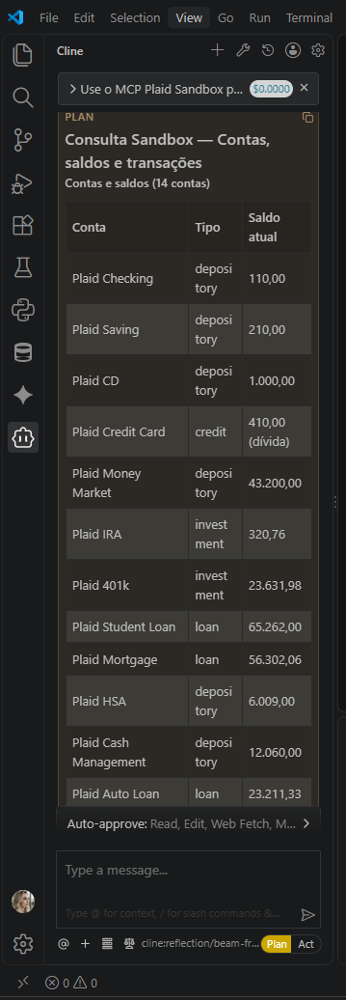
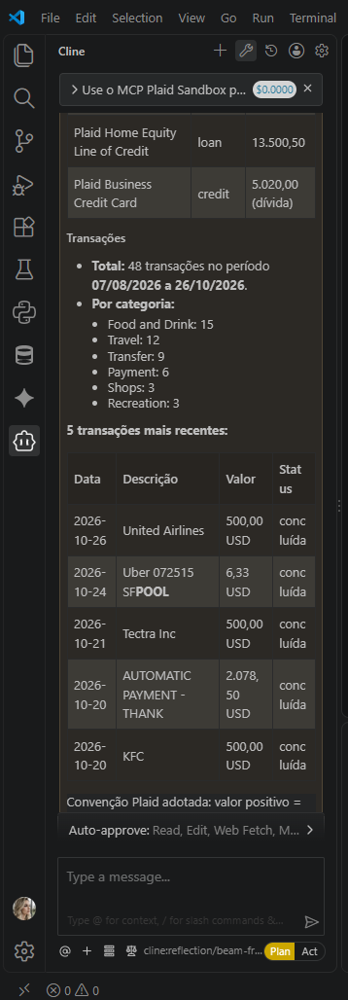
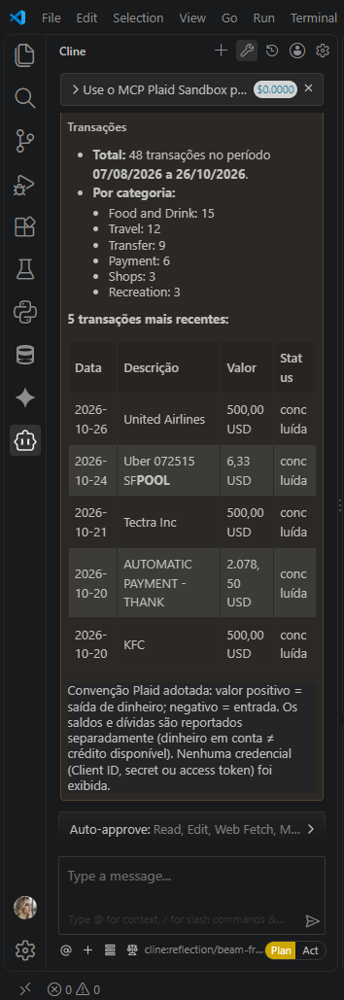
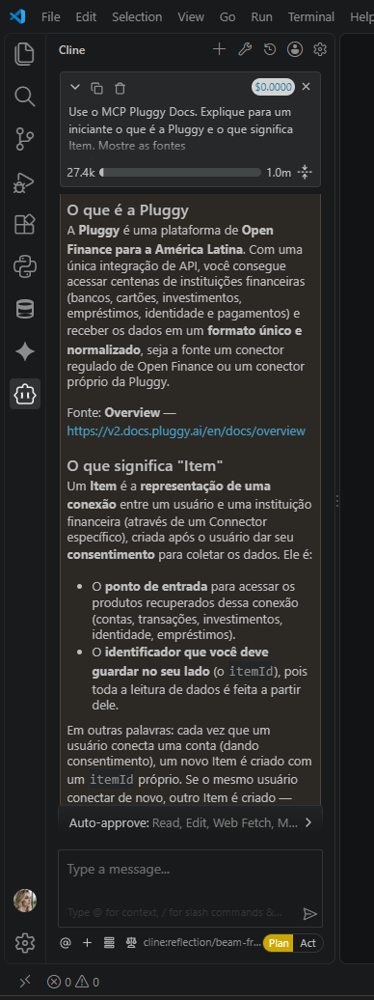
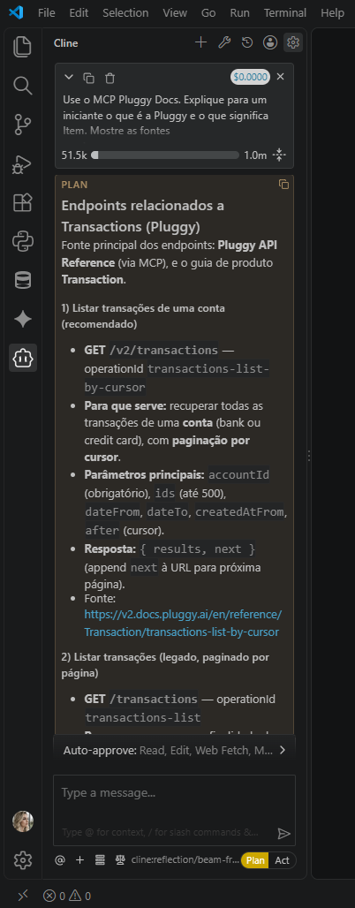

# Core Finance

**Projeto de portfólio de Open Finance | Next.js · TypeScript · Pluggy Sandbox · Supabase**



[](https://github.com/valquiria87/core-finance/actions/workflows/ci.yml)
[](https://core-finance-nine.vercel.app/)
**Somente dados Sandbox — nenhuma conta bancária real.**

[Read in English](README.md)

O Core Finance reúne um dashboard financeiro e uma interface conversacional em português. Organiza snapshots de contas e transações, calcula indicadores por regras e responde perguntas com base nos dados financeiros salvos.

> **Importante:** a aplicação implantada utiliza dados fictícios da Pluggy Sandbox. Não está conectada a contas bancárias reais de clientes e não deve ser usada para decisões financeiras reais.

## Mapa do desafio DIO

| Entregável | Onde está |
|---|---|
| Cliente/usuário e experiência do assistente | O chat voltado ao usuário fica integrado ao dashboard e é aberto pelo botão flutuante “Falar com o Core”. Responde sobre saldos, transações, gastos por categoria/período e padrões disponíveis no snapshot Sandbox; veja as capturas do chat e do dashboard em [evidencias/](evidencias/). |
| Prompt/especificação do builder (v0) | Brief reconstruído abaixo. O prompt original literal não foi preservado no repositório; portanto, este é um resumo fiel do escopo, não uma citação. |
| MCP Pluggy | Servidor remoto Streamable HTTP: `https://mcp.pluggy.ai/mcp`; pesquisa documentada em `evidencias/pluggy-docs-mcp-*.png`. |
| MCP Plaid Sandbox | Servidor local STDIO via `uvx mcp-server-plaid`; configuração ilustrativa com placeholders abaixo. Capturas em `evidencias/plaid-sandbox-*.png`. |
| Melhoria escolhida | **Etapa 2: integração e persistência no servidor** — rota webhook Next.js, adaptador da API Pluggy Sandbox, snapshot no Supabase, deduplicação, lease de retentativa, visão de saúde e alerta por e-mail. |
| Evidências da aplicação final | `evidencias/pluggy-sandbox-dashboard.png`, `pluggy-sandbox-contas-saldos.png`, `pluggy-sandbox-transacoes.png` e `pluggy-sandbox-chat.png`. |

### Brief do builder e ajustes posteriores

**Brief reconstruído do v0 (resumo, não transcrição):** criar um dashboard responsivo de Open Finance com saldos de contas, informações de cartão, transações categorizadas, indicadores de gastos e um chat em português; utilizar uma interface moderna de produto financeiro e dados fictícios para demonstração.

**Ajustes após a geração inicial da interface:** a Pluggy Sandbox foi escolhida como fonte ativa por ser o provedor da integração final no servidor e dos dados persistidos exibidos no dashboard/chat; a Plaid foi mantida como laboratório separado de aprendizado MCP. O app implantado migrou para Route Handlers do Next.js; o servidor consulta contas e transações, adapta os dados ao snapshot interno e persiste no Supabase. O webhook recebeu validação, deduplicação, lease de processamento de cinco minutos, registro de falhas e notificação por e-mail. A apresentação monetária foi alinhada a BRL. A exploração Plaid permanece como laboratório de aprendizado MCP/Sandbox, não como fonte de dados do runtime implantado.

### Configuração dos servidores MCP

**Pluggy — documentação remota, Streamable HTTP**

```json
{
  "mcpServers": {
    "pluggy-docs": {
      "url": "https://mcp.pluggy.ai/mcp"
    }
  }
}
```

**Plaid Sandbox — STDIO local via uvx**

```json
{
  "mcpServers": {
    "plaid": {
      "command": "uvx",
      "args": [
        "mcp-server-plaid",
        "--client-id",
        "YOUR_PLAID_CLIENT_ID",
        "--secret",
        "YOUR_PLAID_SECRET"
      ]
    }
  }
}
```

Use somente credenciais **Plaid Sandbox** neste laboratório. Nunca inclua credenciais no README, em capturas de tela, no controle de versão ou no chat. As imagens Plaid são evidências históricas da exploração Sandbox: registram 14 contas e 48 transações nas capturas, não representam o runtime atual integrado à Pluggy.

## Funcionalidades

- Visão geral de contas e saldos; fatura e limite do cartão são apresentados separadamente.
- Lista de transações, categorias e filtros.
- Resumos de gastos por categoria e período.
- Chat em português para perguntas sobre saldos, transações e gastos.
- Formatação monetária em reais (BRL).
- Webhook Pluggy atualiza o Item Sandbox configurado e persiste o snapshot resultante.

**Implementação do assistente:** o chat atual é **determinístico, baseado em regras e palavras-chave**, implementado em `lib/core-engine.ts`. Não chama um LLM nem executa ferramentas MCP próprias. Um servidor MCP dedicado, LLM com chamadas de ferramentas e avaliação sistemática de perguntas/respostas permanecem no roadmap. O projeto não é apresentado como um agente de IA em produção.

## Destaques de engenharia

- **Snapshot persistido:** respostas da API Pluggy são normalizadas por `lib/pluggy-adapter.ts` e salvas em `finance_snapshots` no Supabase.
- **Idempotência do webhook:** `webhook_events.event_id` impede o registro duplicado de um mesmo evento.
- **Lease e compare-and-set:** lease de cinco minutos permite recuperar eventos antigos/falhos; atualizações condicionais impedem que uma execução antiga sobrescreva uma reivindicação mais recente.
- **Testes de contrato:** autenticação Pluggy simulada, contas, paginação de transações e adaptação dos dados.
- **Testes do webhook:** validação, autenticação, duplicidade, recuperação de lease, sincronização e falhas.
- **Notificação de falha:** `lib/webhook-alert-email.ts` envia e-mail quando a sincronização do webhook falha, se o SMTP do Gmail estiver configurado.

## Arquitetura

A aplicação Next.js utiliza Route Handlers no servidor. O dashboard e o chat leem o último snapshot sincronizado no Supabase; não consultam a Pluggy de forma independente a cada carregamento.



### Rotas de API

| Rota | Finalidade |
|---|---|
| `GET /api/sandbox` | Retorna o snapshot financeiro salvo mais recente. |
| `POST /api/core` | Responde usando o snapshot e regras determinísticas. |
| `GET /api/insights` | Calcula os indicadores atualmente implementados. |
| `POST /api/webhooks/pluggy` | Valida notificação Pluggy, atualiza dados e persiste o snapshot. |

A aplicação Express em `backend/` é um protótipo separado, não o backend que atende à aplicação Next.js implantada.

## Dados e persistência

- **Provedor ativo:** Pluggy Sandbox API.
- **Laboratório de aprendizado:** Plaid Sandbox MCP e capturas históricas.
- **Persistência:** Supabase Postgres.
- **Snapshot:** `finance_snapshots`, identificado pelo Pluggy Item ID.
- **Eventos:** `webhook_events`, com ID, tipo, status, tentativas e horários de processamento.
- **Saúde do webhook:** visão agregada restrita `webhook_event_health`.
- **Credenciais:** Pluggy, Supabase e Gmail são variáveis de ambiente exclusivas do servidor.

O último snapshot Pluggy Sandbox validado continha 2 contas e 41 transações. Quantidades e valores podem mudar com a atualização da Sandbox. Os dados são fictícios. O snapshot não fornece histórico de saldos bancários.

## Limitações atuais

- Não há conexão de produção com instituições financeiras nem dados reais de clientes.
- O assistente é determinístico; não há LLM nem servidor MCP próprio integrado.
- A identificação de estabelecimentos no chat usa uma pequena lista fixa de palavras-chave (por exemplo, delivery, Uber, Netflix, Starbucks e Amazon); não é resolução geral de entidades.
- A detecção de despesas recorrentes agrupa transações pelo nome do estabelecimento e verifica quantidade de ocorrências e dispersão dos valores. **Não valida o intervalo entre cobranças nem comprova que o pagamento é uma assinatura.**
- A projeção de fim de mês usa a data atual e uma média diária simples do mês até o momento. Não é backtest histórico nem previsão ajustada à sazonalidade; deve ser interpretada apenas como heurística indicativa.
- A detecção de anomalias é uma regra estatística simples sobre a amostra disponível, não um modelo treinado.
- O webhook é síncrono; não existe fila durável em segundo plano.
- O webhook utiliza segredo compartilhado em cabeçalho e comparação em tempo constante, **não assinatura HMAC do corpo**. Proteção específica contra replay ainda não foi implementada.
- Rotas públicas e ausência de rate limit exigem revisão de segurança antes de qualquer uso com dados reais.
- O histórico Sandbox não equivale a um extrato completo nem a uma série histórica de saldos.

## Variáveis de ambiente

Copie `.env.example` para um arquivo local e configure os valores no servidor. Nunca versione credenciais reais.

| Variável | Finalidade |
|---|---|
| `PLUGGY_CLIENT_ID`, `PLUGGY_CLIENT_SECRET` | Autenticação na API Pluggy |
| `PLUGGY_ITEM_ID` | Item Sandbox configurado |
| `PLUGGY_WEBHOOK_SECRET` | Segredo esperado no cabeçalho do webhook |
| `SUPABASE_URL`, `SUPABASE_SECRET_KEY` | Acesso server-side ao Supabase |
| `GMAIL_USER` | Conta Gmail usada no SMTP |
| `GMAIL_APP_PASSWORD` | Senha de app do Google, não a senha normal da conta |
| `ALERT_EMAIL_TO` | Destinatário dos alertas de falha do webhook |

O alerta é enviado quando a sincronização do webhook falha e as três variáveis Gmail estão configuradas. Um deploy bem-sucedido, isoladamente, não comprova autenticação SMTP.

## Executar localmente

Requisitos: Node.js e pnpm.

```bash
pnpm install
cp .env.example .env.local
pnpm dev
```

Acesse `http://localhost:3000`.

### Validação

```bash
pnpm test
pnpm exec tsc --noEmit
pnpm build
```

## Evidências

### Aplicação Pluggy Sandbox






### Laboratório Plaid Sandbox





### Pesquisa de documentação MCP




Todos os registros financeiros nas capturas são dados de teste ou Sandbox.

## Roadmap

- [x] Integração server-side com Pluggy Sandbox e persistência do snapshot no Supabase.
- [x] Deduplicação de eventos, lease de processamento, visão de saúde e e-mail de falha.
- [x] Testes de contrato Pluggy e testes do webhook.
- [ ] Criar servidor MCP próprio com ferramentas financeiras seguras e somente leitura.
- [ ] Integrar LLM com chamadas explícitas de ferramentas e autorização no servidor.
- [ ] Criar conjunto de avaliação de perguntas/respostas (correção, fundamentação, recusas e regressões).
- [ ] Implementar proteção contra replay, processamento assíncrono durável, rate limiting e revisão ampliada de controle de acesso.
- [ ] Gravar demonstração de 60–90 segundos para a entrega DIO e o portfólio de recrutadores.

## Segurança

Consulte [SECURITY.md](SECURITY.md) para controles implementados, lacunas conhecidas e reporte de vulnerabilidades.

## Licença

MIT — consulte [LICENSE](LICENSE).

## Autoria

**Valquiria Coelho**
