# Core Finance

**Projeto de portfólio de Open Finance | Next.js · TypeScript · Plaid Sandbox · Pluggy · Supabase**


[](https://github.com/valquiria87/core-finance/actions/workflows/ci.yml)
[](https://core-finance-nine.vercel.app/)
**Somente dados Sandbox — nenhuma conta bancária real.**

[Read in English](README.md)

O Core Finance reúne um dashboard financeiro e uma interface conversacional em português. Organiza snapshots de contas e transações, calcula indicadores por regras e responde perguntas com base nos dados financeiros salvos.

> **Importante:** o dashboard e o chat consultam dados fictícios da Plaid Sandbox. Pluggy permanece como integração alternativa independente. Nenhuma das integrações usa contas bancárias reais neste projeto.

**Aplicação publicada:** https://core-finance-nine.vercel.app/

**Cenário do cliente:** uma pessoa que já administra as finanças pelo banco digital quer reunir em um só lugar dinheiro disponível, dívidas, investimentos, transações e padrões de gastos, além de fazer perguntas em português por uma interface conversacional.

## Mapa do desafio DIO

| Entregável | Onde está |
|---|---|
| Cliente/usuário e experiência do assistente | O chat voltado ao usuário fica integrado ao dashboard e é aberto pelo botão flutuante “Falar com o Core”. Responde sobre saldos, transações, gastos por categoria/período e padrões disponíveis no snapshot Sandbox; veja as capturas do chat e do dashboard em [evidencias/](evidencias/). |
| Prompt/especificação do builder (v0) | [Especificação OpenSpec reconstruída](docs/prompt-lovable.md), com a proveniência e as diferenças em relação à implementação final declaradas. O prompt original literal não foi preservado. |
| MCP Pluggy | Servidor remoto Streamable HTTP: `https://mcp.pluggy.ai/mcp`; pesquisa documentada em `evidencias/pluggy-docs-mcp-*.png`. |
| MCP no runtime do chat | Servidor e cliente MCP internos via SDK oficial; ferramenta somente leitura `get_finance_snapshot` fornece o snapshot Plaid ao chat. |
| Edge Function MCP Pluggy | Implementação separada em `supabase/functions/dio-bank-mcp`, com transporte Streamable HTTP e ferramenta `resumo_mensal`; testes locais aprovados, secrets configurados no Supabase, mas ainda sem deploy. |
| Integração Plaid Sandbox | SDK oficial no servidor Next.js para consultar contas e transações. |
| Melhoria escolhida | **Integração financeira server-side:** Plaid Sandbox alimenta dashboard e chat; Pluggy mantém adaptador, persistência Supabase e webhook independentes. |
| Evidências disponíveis | As capturas `plaid-sandbox-*.png` documentam o laboratório MCP/Plaid realizado em outubro de 2026; são evidências históricas, não uma captura da interface atual. As imagens `pluggy-sandbox-*.png` pertencem ao protótipo anterior Pluggy. |

### Melhorias e aprendizados após a geração inicial

#### O que melhorou

- A integração principal do dashboard e do chat foi consolidada no Plaid Sandbox, com credenciais mantidas exclusivamente no servidor.
- O chat passou a obter o snapshot por uma chamada real de ferramenta MCP (`get_finance_snapshot`), usando o SDK oficial e transporte em memória dentro do backend Next.js.
- Contas e transações são normalizadas em um formato interno comum; a consulta de transações percorre a paginação por cursor e limita os registros aos últimos 90 dias.
- A moeda de cada conta e transação é preservada, evitando apresentar valores em USD como BRL ou somar moedas diferentes.
- O endpoint de indicadores foi alinhado ao mesmo snapshot Plaid usado pelo dashboard, eliminando a dependência acidental do snapshot Pluggy nessa rota.
- Pluggy foi mantido como integração alternativa independente, sem substituir o caminho Plaid.
- Os totais de contas agora separam dinheiro disponível, dívidas de cartão/empréstimo e investimentos, sem somar saldos de naturezas diferentes.
- Pagamentos de fatura e transferências internas são excluídos dos fluxos de caixa externos para evitar dupla contagem.
- Transações com categoria desconhecida do provedor são identificadas como **Outros / não classificados**, em vez de serem atribuídas incorretamente a Compras.

#### O que aprendi

- Configurar um servidor MCP no cliente de desenvolvimento não significa que a aplicação web passe a executar ferramentas MCP em produção.
- Integrações financeiras precisam manter credenciais no servidor, tratar paginação, validar respostas externas e preservar a moeda de cada registro.
- Adaptadores isolam diferenças entre provedores; testes de contrato e de rotas ajudam a detectar regressões sem depender de chamadas reais durante a suíte.

**Limite importante:** o chat continua determinístico e não usa LLM. Em tempo de execução, o backend cria um servidor MCP e um cliente MCP no mesmo processo; o cliente chama a ferramenta somente leitura `get_finance_snapshot`, que consulta a Plaid Sandbox no servidor. O transporte é em memória, portanto não há endpoint MCP remoto/publicamente acessível. As atividades MCP no cliente de desenvolvimento e o MCP interno do runtime são fluxos distintos.

### Brief reconstruído do v0
### Por que a implementação final usa Next.js em vez de Lovable

O Lovable fez parte da etapa inicial de construção/prototipação. A aplicação final foi implementada em Next.js para permitir controle direto da integração server-side com o SDK Plaid, do tratamento de credenciais, das rotas de API, do runtime MCP interno, dos fluxos Pluggy/Supabase e dos testes automatizados. Foi uma decisão de implementação para tornar esses fluxos de backend e suas limitações explícitos e testáveis; isso não significa que o brief original exigisse Next.js nem que o Lovable seja incapaz de oferecer suporte a integrações. A especificação reconstruída registra a direção inicial, enquanto o repositório documenta a arquitetura final.


**Brief reconstruído do v0 (resumo, não transcrição):** criar um dashboard responsivo de Open Finance com saldos de contas, informações de cartão, transações categorizadas, indicadores de gastos e um chat em português; utilizar uma interface moderna de produto financeiro e dados fictícios para demonstração.

**Integrações:** o runtime Next.js consulta a Plaid Sandbox no servidor com o SDK oficial, busca contas por `/accounts/get` e percorre todas as páginas de `/transactions/sync`. As respostas são normalizadas no formato interno `SandboxSnapshot`. `/api/sandbox` consulta a Plaid diretamente; `/api/core` obtém o snapshot por meio da ferramenta MCP interna antes de executar o motor determinístico de respostas. A Pluggy permanece disponível por seus próprios módulos, webhook e persistência; não participa do caminho Plaid.

### Configuração dos servidores MCP

**Pluggy — documentação remota, Streamable HTTP**

```json
{
  "mcpServers": {
    "pluggy-docs": {
      "url": "https://mcp.pluggy.ai/mcp"
    }
  }
}
```

**Plaid Sandbox — STDIO local via uvx**

```json
{
  "mcpServers": {
    "plaid": {
      "command": "uvx",
      "args": ["mcp-server-plaid"],
      "env": {
        "PLAID_CLIENT_ID": "${PLAID_CLIENT_ID}",
        "PLAID_SECRET": "${PLAID_SECRET}"
      }
    }
  }
}
```

Use somente credenciais **Plaid Sandbox**. Nunca inclua credenciais no README, em capturas de tela, no controle de versão ou no chat. As imagens Plaid são evidências históricas e podem diferir dos dados retornados pela API atual.

## Funcionalidades

- Visão geral de contas e saldos; fatura e limite do cartão são apresentados separadamente.
- Lista de transações, categorias e filtros.
- Resumos de gastos por categoria e período.
- Chat em português para perguntas sobre saldos, transações e gastos.
- Formatação monetária conforme a moeda informada pelo provedor; o snapshot Plaid Sandbox atualmente validado usa USD. Não há conversão cambial.
- Webhook Pluggy atualiza o Item Sandbox configurado e persiste o snapshot resultante.

**Implementação do assistente:** o chat atual é **determinístico, baseado em regras e palavras-chave**, implementado em `lib/core-engine.ts`. Não chama um LLM nem executa ferramentas MCP próprias. A implantação do servidor MCP remoto, a integração de um LLM com chamadas de ferramentas e a avaliação sistemática de perguntas/respostas permanecem no roadmap. A Edge Function `dio-bank-mcp` já foi implementada localmente, mas ainda não foi implantada. O projeto não é apresentado como um agente de IA em produção.

## Destaques de engenharia

- **Snapshot persistido:** respostas da API Pluggy são normalizadas por `lib/pluggy-adapter.ts` e salvas em `finance_snapshots` no Supabase.
- **Idempotência do webhook:** `webhook_events.event_id` impede o registro duplicado de um mesmo evento.
- **Lease e compare-and-set:** lease de cinco minutos permite recuperar eventos antigos/falhos; atualizações condicionais impedem que uma execução antiga sobrescreva uma reivindicação mais recente.
- **Testes de contrato:** autenticação Pluggy simulada, contas, paginação de transações e adaptação dos dados.
- **Testes do webhook:** validação, autenticação, duplicidade, recuperação de lease, sincronização e falhas.
- **Notificação de falha:** `lib/webhook-alert-email.ts` envia e-mail quando a sincronização do webhook falha, se o SMTP do Gmail estiver configurado.

## Arquitetura

A aplicação Next.js utiliza Route Handlers no servidor. O dashboard consulta a Plaid diretamente; o chat chama a ferramenta MCP interna `get_finance_snapshot`, que usa a mesma integração Plaid. O fluxo Pluggy e sua persistência Supabase permanecem independentes.

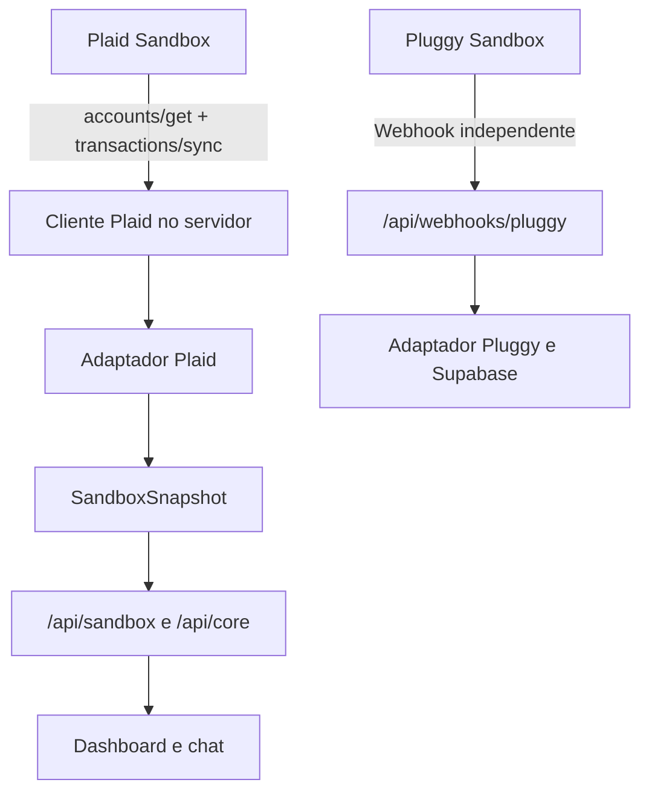

### Rotas de API

| Rota | Finalidade |
|---|---|
| `GET /api/sandbox` | Consulta Plaid Sandbox e retorna o snapshot normalizado do dashboard. |
| `POST /api/core` | Chama `get_finance_snapshot` pelo cliente MCP interno e responde com regras determinísticas. |
| `GET /api/insights` | Calcula os indicadores atualmente implementados. |
| `POST /api/webhooks/pluggy` | Valida notificação Pluggy, atualiza dados e persiste o snapshot. |
| `POST /api/webhooks/plaid` | Valida o JWT ES256 `Plaid-Verification` e confirma o recebimento; não dispara sincronização do snapshot. |

A aplicação Express em `backend/` é um protótipo separado, não o backend que atende à aplicação Next.js implantada.

## Dados e persistência

- **Fonte principal do dashboard e chat:** Plaid Sandbox API.
- **Alternativa independente:** Pluggy Sandbox API e webhook.
- **Persistência Pluggy:** Supabase Postgres; o fluxo Plaid atual consulta a API diretamente e não altera tabelas Supabase.
- **Eventos:** `webhook_events`, com ID, tipo, status, tentativas e horários de processamento.
- **Saúde do webhook:** visão agregada restrita `webhook_event_health`.
- **Credenciais:** Plaid, Pluggy, Supabase e Gmail são variáveis de ambiente exclusivas do servidor.

O último snapshot Pluggy Sandbox validado continha 2 contas e 41 transações. Quantidades e valores podem mudar com a atualização da Sandbox. Os dados são fictícios. O snapshot não fornece histórico de saldos bancários.

## Limitações atuais

- Não há conexão de produção com instituições financeiras nem dados reais de clientes.
- O assistente é determinístico e não usa LLM nem seleção autônoma de ferramentas. O backend chama uma ferramenta MCP interna por transporte em memória; não há servidor MCP remoto acessível integrado ao chat.
- A identificação de estabelecimentos no chat usa uma pequena lista fixa de palavras-chave (por exemplo, delivery, Uber, Netflix, Starbucks e Amazon); não é resolução geral de entidades.
- A detecção de despesas recorrentes agrupa transações pelo nome do estabelecimento e verifica quantidade de ocorrências e dispersão dos valores. **Não valida o intervalo entre cobranças nem comprova que o pagamento é uma assinatura.**
- A projeção de fim de mês usa a data atual e uma média diária simples do mês até o momento. Não é backtest histórico nem previsão ajustada à sazonalidade; deve ser interpretada apenas como heurística indicativa.
- A detecção de anomalias é uma regra estatística simples sobre a amostra disponível, não um modelo treinado.
- O webhook é síncrono; não existe fila durável em segundo plano.
- O webhook Pluggy utiliza segredo compartilhado em cabeçalho e comparação em tempo constante, **não assinatura HMAC do corpo**; a deduplicação por `eventId` e a lease protegem contra reprocessamento concorrente, mas não substituem uma verificação criptográfica de timestamp/nonce.
- A rota Plaid valida o JWT ES256, o hash do corpo e a janela de `iat`, mas apenas confirma o recebimento; sua deduplicação usa memória do processo e não é durável.
- Rotas públicas e ausência de rate limit exigem revisão de segurança antes de qualquer uso com dados reais.
- O histórico Sandbox não equivale a um extrato completo nem a uma série histórica de saldos.

## Variáveis de ambiente

Copie `.env.example` para um arquivo local e configure os valores no servidor. Nunca versione credenciais reais.

As rotas Plaid requerem `PLAID_CLIENT_ID`, `PLAID_SECRET`, `PLAID_ENV=sandbox` e `PLAID_ACCESS_TOKEN`. O token deve ser obtido no fluxo Plaid Sandbox e configurado somente no ambiente server-side. Não use variáveis `NEXT_PUBLIC_*`.

| Variável | Finalidade |
|---|---|
| `PLAID_CLIENT_ID`, `PLAID_SECRET` | Autenticação SDK Plaid no servidor |
| `PLAID_ENV` | Ambiente Plaid; este projeto valida `sandbox` |
| `PLAID_ACCESS_TOKEN` | Acesso server-side ao Item Sandbox vinculado |
| `PLUGGY_CLIENT_ID`, `PLUGGY_CLIENT_SECRET` | Autenticação na API Pluggy |
| `PLUGGY_ITEM_ID` | Item Sandbox configurado |
| `MCP_TOKEN` | Token Bearer usado somente pela Edge Function `dio-bank-mcp`; configurar nos secrets do Supabase, nunca no navegador ou em arquivo versionado. |
| `PLUGGY_WEBHOOK_SECRET` | Segredo esperado no cabeçalho do webhook |
| `SUPABASE_URL`, `SUPABASE_SECRET_KEY` | Acesso server-side ao Supabase |
| `GMAIL_USER` | Conta Gmail usada no SMTP |
| `GMAIL_APP_PASSWORD` | Senha de app do Google, não a senha normal da conta |
| `ALERT_EMAIL_TO` | Destinatário dos alertas de falha do webhook |

O alerta é enviado quando a sincronização do webhook falha e as três variáveis Gmail estão configuradas. Um deploy bem-sucedido, isoladamente, não comprova autenticação SMTP.

## Executar localmente

Requisitos: Node.js e pnpm.

```bash
pnpm install
cp .env.example .env.local
pnpm dev
```

Acesse `http://localhost:3000`.

### Validação

```bash
pnpm test
pnpm exec tsc --noEmit
pnpm build
```

## Evidências

### Evidências históricas da interface do Core Finance

As capturas abaixo documentam uma validação local anterior às últimas correções do modelo de dados. Mostram o dashboard em desktop e mobile e respostas determinísticas do chat. São evidências históricas da interface, não uma captura da versão atualmente publicada. Todos os registros são dados fictícios da Plaid Sandbox.

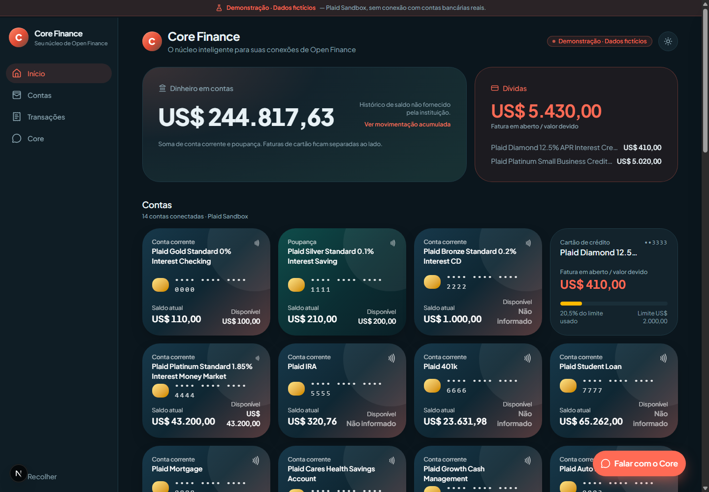
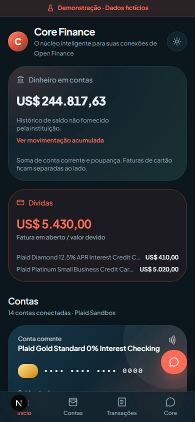
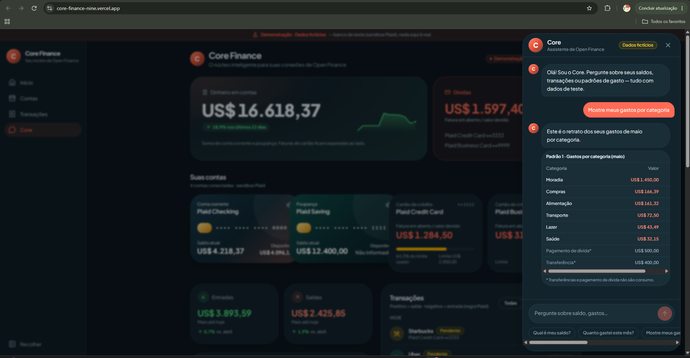
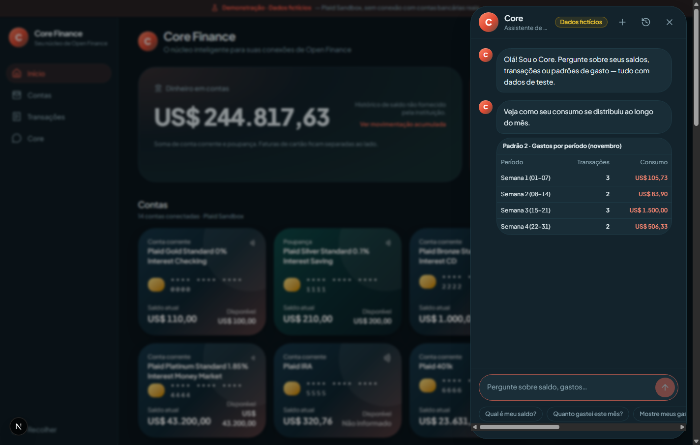
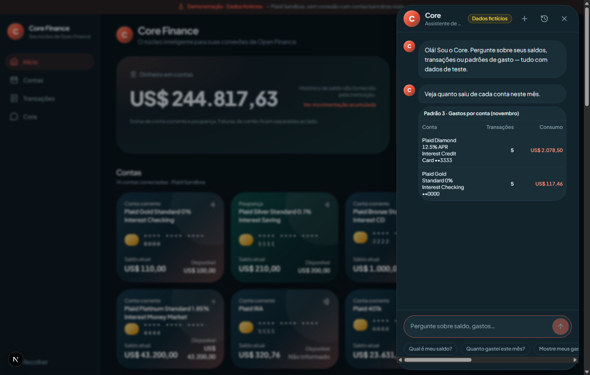

### Protótipo anterior Pluggy Sandbox

As imagens abaixo registram uma versão anterior do protótipo e não representam a fonte de dados da aplicação local atual.

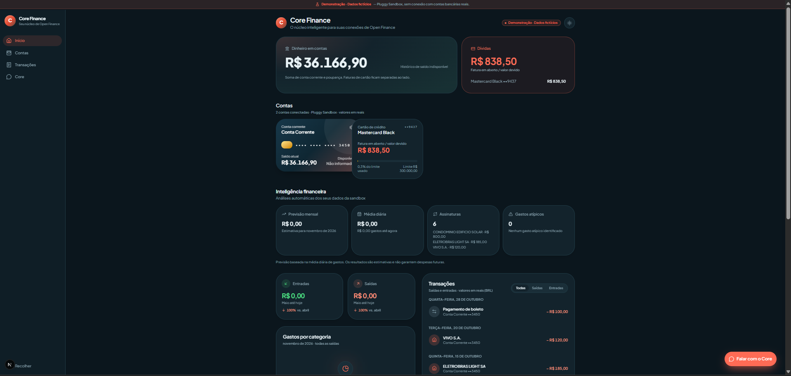
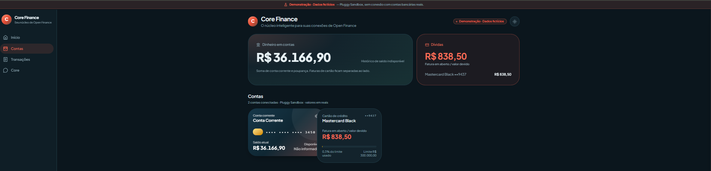
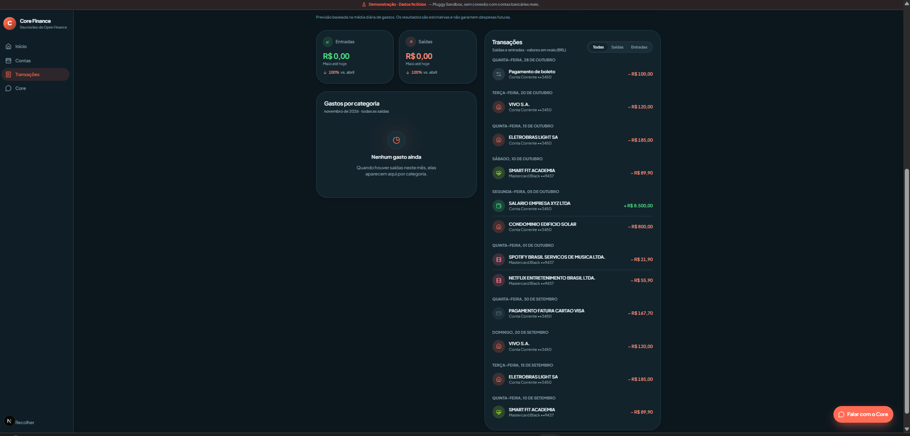
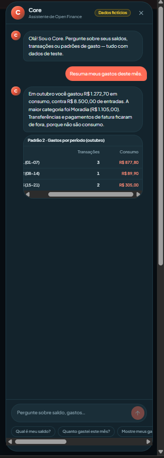

### Evidências históricas do laboratório MCP/Plaid Sandbox (outubro de 2026)

Estas capturas mostram a execução do servidor Plaid MCP no cliente de desenvolvimento. Os números e datas são daquela consulta, não do snapshot atual.

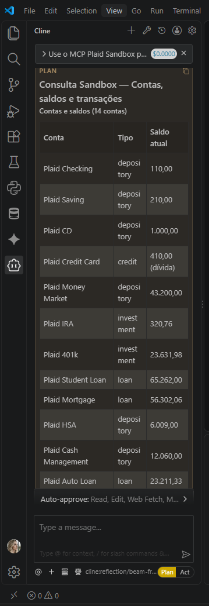
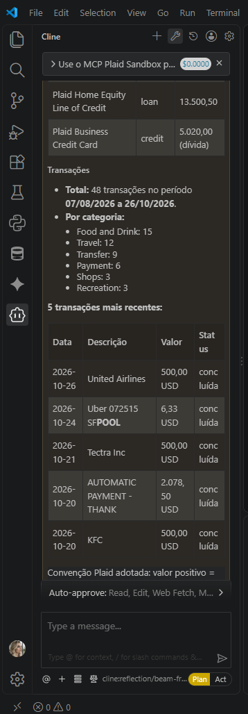
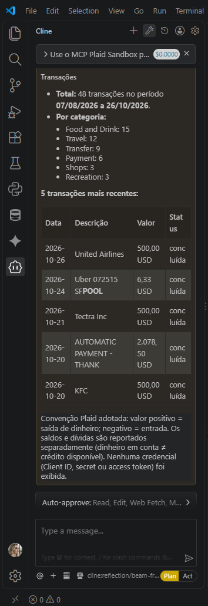

### Pesquisa de documentação MCP

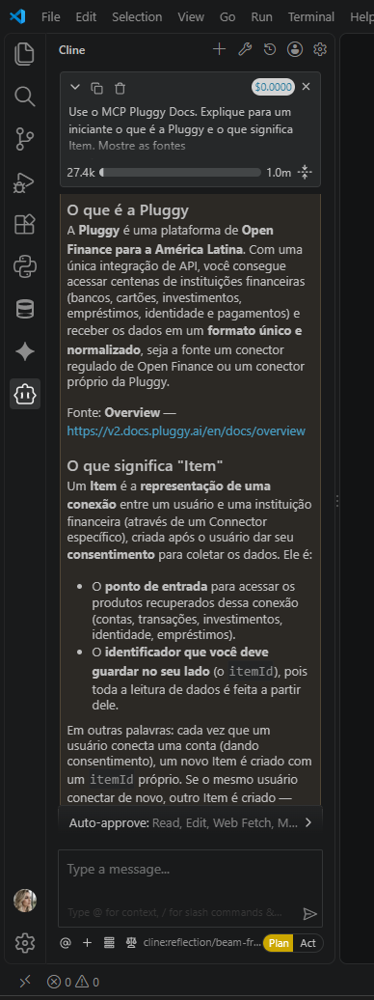
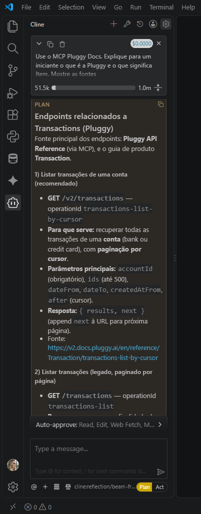

Todos os registros financeiros nas capturas são dados de teste ou Sandbox.

## Roadmap

- [x] Integração server-side com Pluggy Sandbox e persistência do snapshot no Supabase.
- [x] Deduplicação de eventos, lease de processamento, visão de saúde e e-mail de falha.
- [x] Testes de contrato Pluggy e testes do webhook.
- [x] Criar servidor MCP interno com a ferramenta financeira `get_finance_snapshot`, somente leitura, chamada pelo backend do chat.
- [x] Implementar separadamente a Edge Function Pluggy `dio-bank-mcp`, com autenticação Bearer e ferramenta somente leitura `resumo_mensal`; testes locais aprovados.
- [ ] Implantar `dio-bank-mcp` no Supabase e validar seu endpoint Streamable HTTP remoto autenticado.
- [ ] Expor o servidor MCP por transporte remoto autenticado, se necessário para clientes externos.
- [ ] Integrar LLM com chamadas explícitas de ferramentas e autorização no servidor.
- [ ] Criar conjunto de avaliação de perguntas/respostas (correção, fundamentação, recusas e regressões).
- [ ] Implementar proteção contra replay, processamento assíncrono durável, rate limiting e revisão ampliada de controle de acesso.
- [ ] Gravar demonstração de 60–90 segundos para a entrega DIO e o portfólio de recrutadores.

## Segurança

Consulte [SECURITY.md](SECURITY.md) para controles implementados, lacunas conhecidas e reporte de vulnerabilidades.

## Licença

MIT — consulte [LICENSE](LICENSE).

## Autoria

**Valquiria Coelho**

## Atualização do servidor MCP remoto — 25/11/2026

Além do MCP interno descrito acima, foi preparada localmente a Edge Function opcional `supabase/functions/dio-bank-mcp` como melhoria adicional; o briefing oficial do desafio não exige a publicação de um servidor MCP remoto.

- Transporte MCP Streamable HTTP.
- Autenticação própria pelo cabeçalho `Authorization: Bearer`, validada com o secret `MCP_TOKEN`.
- Ferramenta somente leitura `resumo_mensal`, que consulta a Pluggy Sandbox e separa entradas, saídas, saldo líquido e categorias por moeda.
- Testes Deno: 4 aprovados na execução mais recente; `deno check` aprovado anteriormente.
- Os secrets necessários (`MCP_TOKEN`, `PLUGGY_CLIENT_ID`, `PLUGGY_CLIENT_SECRET` e `PLUGGY_ITEM_ID`) foram configurados no projeto Supabase. Os valores permanecem fora do repositório.
- Teste HTTP local anterior: `tools/list` retornou HTTP 200 e token ausente retornou HTTP 401.

**Status:** implementação e testes locais concluídos; secrets configurados no projeto Supabase. A função ainda não foi implantada e, portanto, o endpoint remoto não foi validado. Também não foi concluída a conexão de um cliente Claude. A Edge Function é independente do MCP interno que atende ao chat Next.js. Consulte `supabase/functions/dio-bank-mcp/README.md` para os comandos e payloads de teste.
